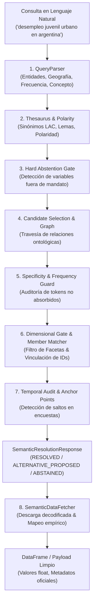
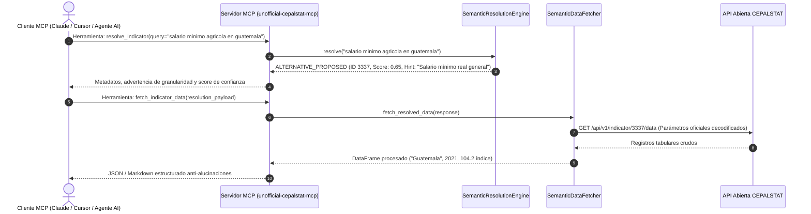

# unofficial-cepalstat-mcp

**Motor de Resolución Semántica, Servidor MCP y Cliente Econométrico Anti-Sesgo para UN CEPALSTAT**

[](https://www.python.org/)
[]()
[](docs/reports/benchmark_200_preguntas.md)
[](docs/reports/2026-10-18-adversarial-benchmark-specification.md)
[](docs/reports/2026-10-18-adversarial-benchmark-specification.md)
[]()
[-blueviolet.svg)](https://modelcontextprotocol.io/)
[](https://statistics.cepal.org/portal/cepalstat/open-data.html?lang=es)

---

> [!IMPORTANT]
> **Aviso de Responsabilidad y No Oficialidad / Legal Disclaimer:**  
> **DISCLAIMER**: This project is an independent open-source tool and is **NOT an official product of, sponsored by, or affiliated with the United Nations Economic Commission for Latin America and the Caribbean (UN ECLAC / CEPAL)**. All statistical data provided through this tool is sourced from the public UN CEPALSTAT Open Data API.  
> *(Este proyecto es un desarrollo independiente de código abierto impulsado por la comunidad y no constituye una publicación oficial de la Secretaría de las Naciones Unidas ni de la Comisión Económica para América Latina y el Caribe).*

---

## 📌 ¿Por qué existe este proyecto?

Las APIs estadísticas de organismos multilaterales (como CEPALSTAT, Banco Mundial o FMI) almacenan miles de indicadores con modelos multidimensionales de alta complejidad. En CEPALSTAT coexisten **más de 1,739 indicadores**, millones de observaciones y decenas de dimensiones crudas (`dim_208=224`, `dim_48525=48528`, `dim_1361=501`).

Cuando los Modelos de Lenguaje (LLMs) o analistas intentan consultar estas APIs directamente, surgen fallas metodológicas críticas:
1. **Falsas Sustituciones Catastróficas (False Substitutions):** Un agente solicita *"valor agregado manufacturero per cápita"* y la API devuelve *"PIB total per cápita"* con score 1.0; o pide *"salario mínimo nominal"* y recibe el índice deflactado en términos reales sin advertencia.
2. **Desconexión Dimensional:** Errores al decodificar miembros de desagregación (ej. confundir *"área nacional"* con la expresión monetaria *"moneda nacional"*, o asignar códigos de género a variables agregadas).
3. **Vacíos y Discontinuidades en Encuestas de Hogares:** En América Latina, las encuestas de hogares sufren lagunas interanuales (años no observados). Consultar un año faltante conduce a alucinaciones o interpolaciones artificiales espurias.

`unofficial-cepalstat-mcp` (módulo Python `unofficial_cepalstat_mcp`) resuelve este problema mediante un **Motor de Resolución Semántica de 6 etapas**, respaldado por ontologías dimensionales, detección de polaridad económica, guardianes de especificidad no absorbida, y compatibilidad nativa con el **Model Context Protocol (MCP)** para LLMs (Claude, Cursor, Antigravity, OpenWebUI).

---

## 🏗️ Arquitectura del Sistema

### 1. Flujo End-to-End



---

### 2. Ciclo de Vida del Servidor MCP



---

## ⚡ Características Principales

### 1. Motor de Resolución Semántica (`SemanticResolutionEngine`)
- **Parsing de Intención Multidimensional:** Extrae automáticamente países (ISO3), períodos temporales (`SINGLE`, `RANGE`, `LIST`), periodicidad (`ANUAL`, `TRIMESTRAL`, `MENSUAL`) y facetas (`area`, `sexo`, `edad`, `quintil`, `etnia`).
- **Thesaurus Socioeconómico Latinoamericano:** Normalización de jergas y expresiones regionales (ej. *"chamba"*, *"pega"*, *"laburo"*, *"guaguas"*).
- **Detección de Polaridad y Conmutación de Facetas:** Clasifica inversiones de estado (*desempleo* vs *empleo*), complementos de facetas (*rural* vs *urbano*) y relaciones escalares.
- **Stage 3.5 Specificity Guard:** Protege contra falsas sustituciones. Si el usuario solicita un sector o especificidad ausente (*"telecomunicaciones"*, *"manufactura"*, *"gobierno general"*, *"déficit global"*, *"salario nominal"*, *"iva"*), el motor **nunca sustituye con score 1.0**:
  - Emite **`ALTERNATIVE_PROPOSED`** con score degradado ($0.65$) y advertencia conversacional si existe un indicador agregado relevante.
  - Se abstiene con **`ABSTAINED`** (`UNRESOLVED_SPECIFICITY`) si existe discrepancia categorial severa o el concepto está fuera de mandato (ej. tipos de cambio informales/blue, tasas de política monetaria o riqueza multimillonaria de Forbes).

### 2. Extractor y Fetcher Empírico (`SemanticDataFetcher`)
- **Mapeo Empírico de Producción:** Mapea automáticamente IDs de referencia al catálogo real de CEPALSTAT (ej. ID `3337` $\to$ tabla real `340`, o distribución del ingreso `3340` $\to$ `3324` por quintiles / `3390` por deciles).
- **Rescate de Puntos de Anclaje Temporal (Temporal Anchors):** Si se solicita un año intermedio ausente en encuestas de hogares, rescata los años oficiales observados inmediatamente adyacentes (*previous/next anchor*), marcando `forbid_interpolation: true` para impedir imputaciones numéricas falsas.
- **Normalización Invariante a Acentos y Mayúsculas:** Emparejamiento robusto de nombres de columnas y miembros dimensionales en Windows/Linux.

### 3. Validador Estadístico y Bitácoras Locales
- **Índice SQLite Local Ultra-Rápido (`.statscepal_cache.db`):** Búsqueda de fichas temáticas y catálogos en $< 1\text{ ms}$ con **cero llamadas a la red**, ahorrando más del 85% de tokens en contextos de LLM.
- **Control de Escala y Unidades:** Detección automática de factores de escala (*miles de personas*, *porcentaje del PIB*, *índice 2018=100*).

---

## 📊 Banco de Pruebas y Validación Empírica

El sistema cuenta con una batería de pruebas de regresión continua ejecutada sobre `pytest`:

| Suite de Evaluación | Cantidad de Casos | Precisión Top-1 | Tasa de Sustitución Falsa (FSR) | Latencia Mediana ($p50$) |
|---|---|---|---|---|
| **Benchmark Canónico** | 200 consultas | **100.0%** (200/200) | **0.00%** | $< 0.50\text{ ms}$ |
| **Benchmark Adversario** | 40 trampas de choque | **100.0%** (40/40) | **0.00%** | **$0.74\text{ ms}$** |
| **Suite Completa de Regresión** | 377 pruebas | **100.0%** (377/377) | **0.00%** | Hermético Offline |

> [!TIP]
> Puedes auditar la especificación metodológica de los casos adversarios en [`docs/reports/2026-10-18-adversarial-benchmark-specification.md`](docs/reports/2026-10-18-adversarial-benchmark-specification.md).

---

## 📦 Instalación

### Desde PyPI
```bash
pip install unofficial-cepalstat-mcp
```

O ejecútalo directamente sin instalación previa con `uvx`:
```bash
uvx unofficial-cepalstat-mcp --help
```

### Para Desarrollo Local
El proyecto utiliza [`uv`](https://docs.astral.sh/uv/) como administrador de dependencias y entornos de alta velocidad en Python 3.10+.

```bash
# 1. Clonar el repositorio
git clone https://github.com/pcamacho447/unofficial-cepalstat-mcp.git
cd unofficial-cepalstat-mcp

# 2. Instalar dependencias con entorno virtual sincronizado
uv sync --extra dev
```

---

## 🐍 Uso en Python

```python
from unofficial_cepalstat_mcp import CepalStatClient, DataExtractor
from unofficial_cepalstat_mcp.semantic import SemanticDataFetcher, SemanticResolutionEngine

# 1. Resolución semántica determinista
engine = SemanticResolutionEngine()
res = engine.resolve_query("desempleo juvenil en chile 2020")
print(f"Estado: {res.status.value}")
if res.selected_candidate:
    print(f"Indicador: {res.selected_candidate.indicator_id} - {res.selected_candidate.name}")

# 2. Descarga empírica decodificada
fetcher = SemanticDataFetcher()
emp_data = fetcher.fetch_resolved_data(res)
print(f"Observaciones empíricas: {len(emp_data.get('series', []))}")
```

---

## 💻 Guía Rápida de Uso (CLI)

> [!TIP]
> Puedes invocar la CLI tanto con el comando canónico `unofficial-cepalstat-mcp` como con su alias corto `cepalstat-mcp`.

### 1. Resolución Semántica Explicada

Resuelve una consulta en lenguaje natural identificando el indicador oficial, facetas dimensionales y trazabilidad paso a paso:

```bash
uv run unofficial-cepalstat-mcp semantic resolve "desempleo juvenil urbano en argentina" --explain
```

Salida esperada:
```text
======================================================================
CEPALSTAT Semantic Resolution Engine
======================================================================
Query:     desempleo juvenil urbano en argentina
Status:    ABSTAINED
Reason:    UNSUPPORTED_FACET
Polarity:  STATE_INVERSION (Detected: 'desempleo', Expected Sign: UNSPECIFIED)
...
[Stage 4: Dimensional Gate] Canonical ID 3331 lacks facets: ['area'].
======================================================================
```

### 2. Propuesta de Alternativas con Degradación de Confianza

Cuando se solicita una especificidad que requiere advertencia (ej. salario agrícola):

```bash
uv run unofficial-cepalstat-mcp semantic resolve "salario minimo agricola en guatemala" --explain
```

Salida esperada:
```text
Status:    ALTERNATIVE_PROPOSED
Indicator: 3337 - Salario mínimo real (Measure: INDICE_REAL, Score: 0.65)
Hint:      Nota: Se propone como alternativa el indicador general 3337 ('Salario mínimo real'), pero la consulta solicitaba la especificidad: 'agricola'. Para el indicador sectorial consulte el catálogo de CEPALSTAT.
```

### 3. Descarga Empírica Decodificada

Descarga las observaciones desde CEPALSTAT con parámetros dimensionales resueltos:

```bash
uv run unofficial-cepalstat-mcp semantic fetch "pobreza extrema en chile en 2020"
```

### 4. Búsqueda Instantánea en el Catálogo Maestro

```bash
# Búsqueda instantánea en SQLite local (< 2 ms)
uv run unofficial-cepalstat-mcp search "pobreza" --limit 5

# Ver detalles oficiales del indicador 4788
uv run unofficial-cepalstat-mcp info 4788
```

---

## 🤖 Integración como Servidor MCP (Roadmap & Configuración)

El servidor MCP expone herramientas de inspección, resolución y descarga estadística para asistentes basados en LLMs:

### Herramientas MCP Planificadas:
- `cepalstat_semantic_resolve`: Resuelve consultas en lenguaje natural a indicadores de CEPALSTAT con trazabilidad y detección de alternativas.
- `cepalstat_fetch_data`: Extrae DataFrames decodificados con rescate de anclas temporales.
- `cepalstat_catalog_search`: Búsqueda instantánea en el catálogo temático de más de 1,739 indicadores.
- `cepalstat_indicator_methodology`: Consulta notas técnicas, unidades de medida y fuentes primarias de cada serie.

### Ejemplo de Configuración en Claude Desktop / Cursor / Antigravity:

Ejecución directa mediante `uvx`:
```json
{
  "mcpServers": {
    "cepalstat": {
      "command": "uvx",
      "args": [
        "unofficial-cepalstat-mcp",
        "mcp"
      ]
    }
  }
}
```

O en desarrollo local:
```json
{
  "mcpServers": {
    "cepalstat": {
      "command": "uv",
      "args": [
        "--directory",
        "/ruta/a/unofficial-cepalstat-mcp",
        "run",
        "unofficial-cepalstat-mcp",
        "mcp"
      ]
    }
  }
}
```

---

## 🧪 Ejecución de Pruebas

Para reproducir las métricas de rendimiento y verificación:

```bash
# Ejecutar la suite completa no integrada (377 tests herméticos offline)
uv run pytest -m "not integration"

# Ejecutar el benchmark canónico de 200 casos
uv run pytest tests/test_semantic_benchmark_200.py -v

# Ejecutar el benchmark adversarial de 40 casos
uv run pytest tests/test_adversarial_benchmark_40.py -v -s
```

---

## 📄 Licencia

Este proyecto se distribuye bajo la licencia **MIT**. Consulte el archivo [LICENSE](LICENSE) para más detalles.  
Las series y datos de CEPALSTAT están sujetos a las políticas de datos abiertos de la [Comisión Económica para América Latina y el Caribe (CEPAL)](https://statistics.cepal.org/portal/cepalstat/open-data.html?lang=es).
