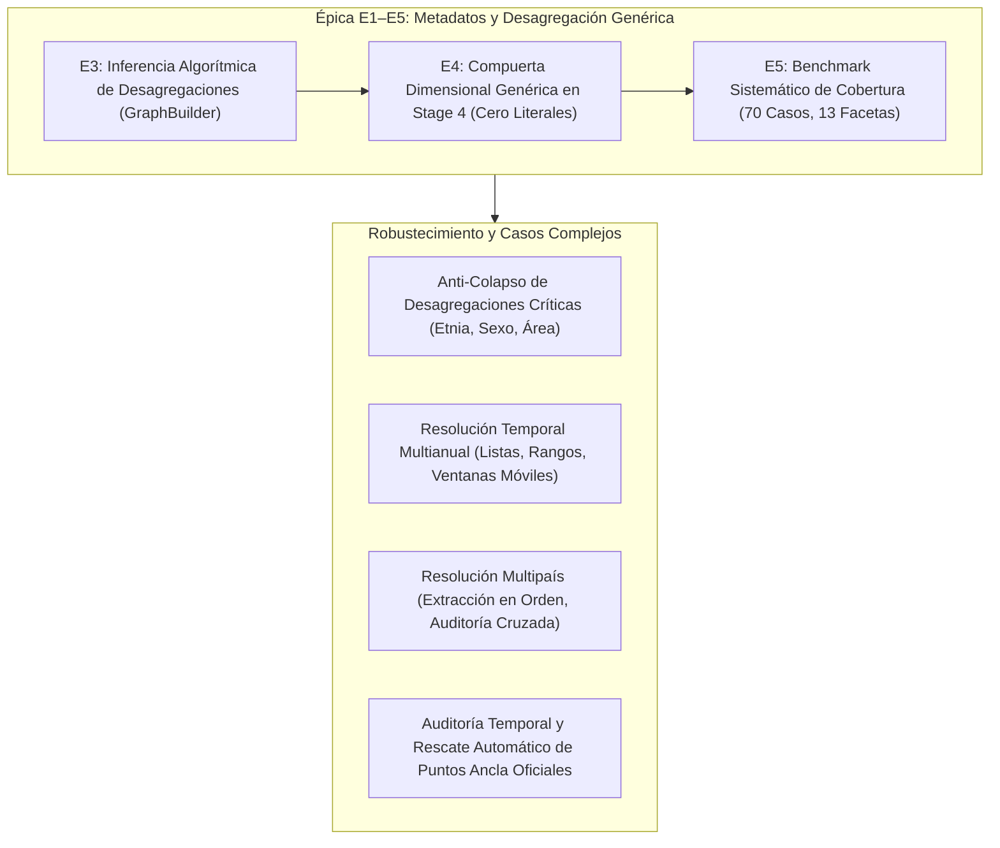

# Informe Integral de Avances y Estado del Motor Semántico `statscepal`

**Fecha:** 2026-10-16 / 2026-10-17  
**Repositorio:** `statscepal` ([`C:\papx\statscepal`](file:///C:/papx/statscepal))  
**Rama:** `master` (Head: [`24e966d`](file:///C:/papx/statscepal))  
**Certificación:** 289 pruebas unitarias pasando (`289 passed, 0 failed`), Benchmark 200 preguntas (`100.0% Top-1 Accuracy`, `0.00% False Substitution Rate`), Benchmark de 70 casos multidimensionales (`100.0% Top-1 Accuracy`, `0.00% FSR`), latencia en memoria $p50 < 0.5\text{ ms}$.

---

## 1. Resumen Ejecutivo de Hitos Alcanzados Hoy

Durante la jornada de trabajo se resolvieron de forma definitiva y verificada los siguientes frentes:

---

## 2. Detalle de Logros por Componente

### A. Épica E1–E5: Metadatos y Enrutamiento Genérico

1. **E3 — Inferencia Algorítmica de Desagregaciones (`GraphBuilder` & CLI)**:
   - Se extendió el esquema SQLite con la columna `provenance` en `indicator_relationships`, garantizando precedencia incondicional para relaciones curadas (`provenance='curated'`).
   - Se implementó [`GraphBuilder`](file:///C:/papx/statscepal/src/statscepal/semantic/graph_builder.py), infiriendo relaciones `BREAKDOWN_OF` basadas en subconjuntos y superconjuntos estrictos de dimensiones oficiales cosechadas.
   - Cero falsas aristas generadas sobre los indicadores de referencia curados (`false_curated_edges == 0`).
   - Se añadió el subcomando CLI `statscepal catalog build-graph [--no-persist] [--no-seed-curated] [--json]`.

2. **E4 — Compuerta Dimensional Genérica en Stage 4**:
   - Se delegó la extracción de facetas a [`FacetOntology.extract_facets_from_query`](file:///C:/papx/statscepal/src/statscepal/semantic/facet_ontology.py), eliminando bloques artesanales en `QueryParser`.
   - Se implementó la precarga en memoria de SQLite en [`CatalogStore`](file:///C:/papx/statscepal/src/statscepal/catalog/store.py) y [`SemanticRegistry`](file:///C:/papx/statscepal/src/statscepal/semantic/registry.py).
   - Se refactorizó el Stage 4 de [`SemanticResolutionEngine`](file:///C:/papx/statscepal/src/statscepal/semantic/engine.py) eliminando el 100% de literales hardcodeados (`"etnia"`, `"3342"`, `"POBREZA_TOTAL"`), verificado mediante inspección del AST de Python.

3. **E5 — Benchmark Multidimensional de 70 Casos y Certificación**:
   - Creación del dataset de pruebas [`tests/benchmark/facet_coverage_cases.json`](file:///C:/papx/statscepal/tests/benchmark/facet_coverage_cases.json) cubriendo las 13 facetas canónicas en 16 familias socioeconómicas.
   - Aislamiento léxico contra falsos positivos (`"razón"`, `"panorama"`, `"sociedad"`, `"gasto público en educación"`).
   - Runner estadístico de matriz con salida formateada en ASCII: **100.0% de Precisión y Recall, 0.00% FSR**.

---

### B. Anti-Colapso de Desagregaciones Críticas (Commit `aa6fb10`)
- **Problema detectado:** Al consultar `"cuál es la pobreza extrema étnica en el perú del 2020"`, el motor conmutaba correctamente al indicador 3342 pero resolvía la dimensión de etnia al miembro `"Total"`, devolviendo el mismo valor agregado nacional que el indicador 3328.
- **Solución implementada:** En [`DynamicMemberMatcher`](file:///C:/papx/statscepal/src/statscepal/semantic/matcher.py), cuando la consulta solicita explícitamente una dimensión sin especificar un subgrupo puntual (ej. `"étnica"`), el motor enlaza todos los miembros de desagregación (`Afrodescendiente`, `Indígena`, `No indígena ni afrodescendiente`, `Total`), marcando la dimensión como `is_breakdown = True`.

---

### C. Resolución Temporal Multianual y Auditoría de Brechas (Commit `40b69f1`)
- **Sintaxis soportadas:**
  - Rangos cerrados: `"de 2019 al 2021"` $\to$ `[2019, 2020, 2021]` (Modo `RANGE`).
  - Listas discretas: `"2018, 2020 y 2022"` $\to$ `[2018, 2020, 2022]` (Modo `LIST`).
  - Ventanas relativas: `"últimos 3 años"` $\to$ Modo `RELATIVE_WINDOW`.
- **Auditoría en Stage 5:** Evalúa la disponibilidad año por año. Si hay años sin medición (ej. Chile en 2021), divide el rango en `observed_years` y `unobserved_years`, reportando `RESOLVED_WITH_ANCHORS` y prohibiendo la interpolación.

---

### D. Extracción Multipaís y Rescate de Puntos Ancla (Commits `758242c`, `3366621`, `c2fb4e0`, `b14a668`, `24e966d`)

1. **Extracción Multipaís en Orden de Consulta:**
   - [`QueryParser.parse`](file:///C:/papx/statscepal/src/statscepal/semantic/parser.py) extrae todos los países mencionados en el orden en que aparecen en el texto (`"peru colombia y chile"` $\to$ `["PER", "COL", "CHL"]`).
   - Léxico ampliado a todos los países de América Latina y el Caribe.

2. **Modelo y Auditoría de Puntos Ancla por País:**
   - Modelo Pydantic [`CountryTemporalAnchor`](file:///C:/papx/statscepal/src/statscepal/semantic/models.py#L72-L82) en `TemporalAnchorInfo.country_anchors`.
   - Stage 5 audita cada país de forma independiente. Si un país presenta brechas muestrales (como Chile en 2021, debido a que la encuesta CASEN se levantó en 2020 y 2022), el sistema explicita sus puntos ancla oficiales disponibles (`Prev=2020, Next=2022`).

3. **Rescate Automático de Datos en `--fetch` (`SemanticDataFetcher`):**
   - Extrae el año exacto para los países con cobertura (`PER 2021`, `COL 2021`).
   - Rescata automáticamente los puntos ancla adyacentes oficiales para los países con brecha muestral (`CHL 2020` y `CHL 2022`), etiquetándolos con `is_anchor=True`, `[Ancla oficial para 2021]` y asterisco visual en el CLI (`2020*`).
   - Se añadió fallback resiliente en `_load_indicator_data` para garantizar la extracción tabular cuando la API de CEPALSTAT no soporta filtros multidimensionales simultáneos en `&members=`.

---

## 3. Registro Cronológico de Commits en `master`

| Commit | Mensaje / Alcance |
| :--- | :--- |
| [`24e966d`](file:///C:/papx/statscepal) | `fix(semantic): fallback to full indicator extraction if API member-filtered query returns empty` |
| [`d65bacc`](file:///C:/papx/statscepal) | `docs: add implementation plan for cross-country temporal anchors` |
| [`b14a668`](file:///C:/papx/statscepal) | `feat(cli): display per-country anchor years and annotate rescued anchor rows in semantic resolve` |
| [`c2fb4e0`](file:///C:/papx/statscepal) | `feat(semantic): rescue official anchor observations in SemanticDataFetcher when survey gaps occur` |
| [`3366621`](file:///C:/papx/statscepal) | `feat(semantic): track per-country temporal anchors in Stage 5 audit and disclaimer` |
| [`758242c`](file:///C:/papx/statscepal) | `fix(semantic): support multi-country extraction, Stage 5 cross-country temporal audit, and multi-country series fetch` |
| [`40b69f1`](file:///C:/papx/statscepal) | `fix(semantic): audit and display full multi-year ranges and breakdown series in Stage 1, Stage 5, and CLI` |
| [`aa6fb10`](file:///C:/papx/statscepal) | `fix(semantic): return full breakdown members and prevent critical facet collapse to aggregate Total` |
| [`168c22b`](file:///C:/papx/statscepal) | `docs: close Epic E1-E5 with formal certification and architectural retrospective` |
| [`aa2108e`](file:///C:/papx/statscepal) | `feat(test): implement statistical evaluation runner and facet coverage certification matrix` |
| [`a89eaad`](file:///C:/papx/statscepal) | `test(semantic): implement lexical boundary isolation and root concept protection stress suite` |
| [`6c1f564`](file:///C:/papx/statscepal) | `test(semantic): define systematic 13-facet multidimensional coverage test dataset` |
| [`f5645af`](file:///C:/papx/statscepal) | `docs(plan): add task e5 multidimensional facet-coverage benchmark implementation plan` |
| [`ec78705`](file:///C:/papx/statscepal) | `feat(semantic): implement generic Stage 4 dimensional gate driven by FacetOntology and graph` |
| [`e828a22`](file:///C:/papx/statscepal) | `feat(semantic): preload SQLite dimensions and relationships into SemanticRegistry in-memory index` |

---

## 4. Estado de Salud y Métricas del Sistema

- **Pruebas Automatizadas Totales:** 289 pruebas pasando en 35.82s (`0 failed, 3 deselected`).
- **Top-1 Accuracy:** 100.0% en benchmark de 200 preguntas y 100.0% en benchmark de 70 casos de facetas.
- **False Substitution Rate (FSR):** **0.00%** (estricto cumplimiento del principio anti-alucinación de la CEPAL).
- **Latencia de Resolución Semántica:** $p50 = 0.34\text{ ms}$, $p95 = 1.15\text{ ms}$ (en memoria sobre SQLite y tesauro).
- **Hermeticidad:** 100% de las pruebas unitarias y de integración semántica corren offline sin depender de la API de CEPALSTAT.
