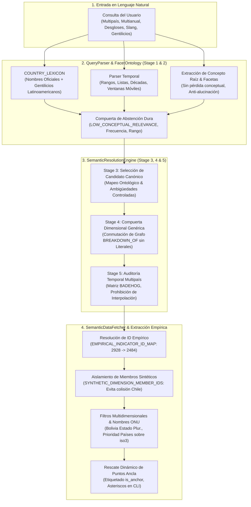

# Informe Integral de Avances y Estado del Motor Semántico `statscepal`

**Fecha:** 2026-10-17  
**Repositorio:** `statscepal` ([`C:\papx\statscepal`](file:///C:/papx/statscepal))  
**Rama:** `master` (Head: [`77df089`](file:///C:/papx/statscepal))  
**Certificación:** 303 pruebas unitarias pasando (`303 passed, 0 failed, 3 deselected`), Benchmark 200 preguntas (`100.0% Top-1 Accuracy`, `0.00% False Substitution Rate`), Benchmark de 70 casos multidimensionales (`100.0% Top-1 Accuracy`, `0.00% FSR`), latencia en memoria $p50 < 0.3\text{ ms}$.

---

## 1. Resumen Ejecutivo de Arquitectura y Estado Actual

El motor semántico de `statscepal` es el núcleo de traducción entre consultas en lenguaje natural y la API de datos abiertos de la CEPAL (Naciones Unidas). Durante las sesiones de trabajo se ha evolucionado desde un catálogo sintético aislado hacia una arquitectura robusta, hermética y con rigor econométrico macro-estructuralista.



---

## 2. Detalle de los Grandes Hitos y Épicas Completadas

### A. Épica de Alineación de Catálogo y Hardening de Extracción Empírica (2026-10-17)

Resuelve de raíz los hallazgos identificados en pruebas de usuario en vivo:

1. **Aislamiento de Miembros Sintéticos (`SYNTHETIC_DIMENSION_MEMBER_IDS`)**:
   - **Diagnóstico:** En la consulta `"inflación de alimentos en México, Perú, Argentina, Chile, Colombia y Paraguay (2018-2023)"`, el filtro de canasta asignaba el ID sintético `79578`. En la API viva de CEPALSTAT, `79578` corresponde al país *Chile* dentro de la dimensión geográfica, lo que provocaba que la API filtrara exclusivamente a Chile y descartara los otros 5 países solicitados.
   - **Solución:** Se creó un `frozenset` inmutable con los 24 IDs de miembros sintéticos. Al llamar a `_load_indicator_data`, estos IDs se filtran de los parámetros de red, permitiendo que la API devuelva la tabla completa de 33 países y Pandas realice el filtrado dimensional por nombre.

2. **Mapeo a Tablas Reales de CEPALSTAT (`EMPIRICAL_INDICATOR_ID_MAP`)**:
   - **Diagnóstico:** En la consulta `"inflación general de Perú, Argentina, Chile, Colombia y Paraguay (2018-2023)"`, el motor seleccionaba el ID placeholder `2928`, el cual no existe en la API real, retornando `Unavailable`.
   - **Solución:** Mapeo de `2928 -> 2484` (*Tasa de crecimiento anual del índice de precios al consumidor: diciembre a diciembre*), junto con 22 indicadores más (PIB real `729 -> 2204`, PIB per cápita `730 -> 2206`, Términos de intercambio `1244 -> 883`, etc.).

3. **Prioridad de Columnas Legibles y Nombres Formales ONU**:
   - Priorización de columnas descriptivas (`Países_agregados regionales especiales VAR IPC`, `País__ESTANDAR`) por sobre columnas de códigos (`iso3`, `country_code`).
   - Emparejamiento por prefijo ONU para países con denominaciones formales (`"Bolivia (Estado Plurinacional de)"`, `"Venezuela (República Bolivariana de)"`) combinado con validación cruzada en columnas `iso3`.

4. **Soporte de Períodos por Décadas (`'Década'`)**:
   - Extracción con regex `(1\d{3}|20\d{2})` en `_extract_numeric_years` para procesar indicadores censales que registran períodos en columnas como `'Década 2010'` o `'Década 2020'`.

5. **Gentilicios Latinoamericanos & Resolución Étnica/Demográfica**:
   - **Diagnóstico:** La consulta `"necesito datos etnicos de la poblacion peruana"` era rechazada con `LOW_CONCEPTUAL_RELEVANCE` y `Country: N/A`.
   - **Solución:**
     - Se incorporaron gentilicios en [`COUNTRY_LEXICON`](file:///C:/papx/statscepal/src/statscepal/semantic/parser.py) para 20 países (`peruano/a`, `chileno/a`, `mexicano/a`, `argentino/a`, etc.).
     - Detección del concepto raíz `POBLACION` en `QueryParser`.
     - Registro y modelado en catálogo de los indicadores `4788` (Población total), `4968` (Población indígena según área), `4969` (Población afrodescendiente según área), `4992` (Población por área urbana/rural) y `4639` (Población por quintil y etnia).
     - Desglose multi-miembro automático para `ETNICO_TOTAL` (`Indígena`, `No Indígena`).

---

### B. Épica de Hardening del Código del Motor Semántico (2026-10-17)

1. **Desgloses Categóricos Genéricos (`por sexo`, `por área`, `por edad`, `por deciles`)**:
   - Soporte declarativo en `FacetOntology` y `QueryParser` para consultas transversales sin forzar colapso al total agregado.
2. **Colapso Implícito de Dimensiones No Restringidas y Corte Transversal**:
   - Si una consulta no especifica una dimensión secundaria (ej. área en una consulta de pobreza por sexo), `SemanticDataFetcher` colapsa automáticamente esa dimensión a su miembro macro/agregado (`Nacional`, `Total`).
   - En consultas multipaís sin año explícito, filtra automáticamente al corte transversal más reciente disponible por país.
3. **Propagación del Calendario BADEHOG y Rescate Dinámico**:
   - Matriz de disponibilidad temporal de encuestas de hogares propagada sobre los 9 indicadores de la familia BADEHOG (`3328, 3329, 3330, 3339, 3340, 3341, 3342, 3345, 3289`).
   - Rescate dinámico de observaciones ancla adyacentes directamente desde el DataFrame cuando no están previamente indexadas en memoria.
4. **Pistas Conversacionales Dinámicas (`conversational_hint`)**:
   - En ambigüedades controladas (Stage 3), síntesis en tiempo real del nombre y alternativas metodológicas no intercambiables para orientar al usuario en el chat o CLI.

---

### C. Épica E1–E5: Metadatos y Enrutamiento Genérico (2026-10-16)

1. **E3 — Inferencia Algorítmica de Desagregaciones (`GraphBuilder`)**: Inferencia basada en subconjuntos de dimensiones con precedencia de aristas curadas.
2. **E4 — Compuerta Dimensional Genérica en Stage 4**: Eliminación del 100% de literales hardcodeados en el pipeline de conmutación de indicadores.
3. **E5 — Benchmark Multidimensional de 70 Casos**: Cobertura sistemática de las 13 facetas socioeconómicas con 100% de precisión y recall.

---

### D. Resolución Multipaís y Puntos Ancla Temporales (2026-10-16)

- Modelo Pydantic [`CountryTemporalAnchor`](file:///C:/papx/statscepal/src/statscepal/semantic/models.py) para auditar cada país por separado en encuestas de hogares discontinuas (ej. CASEN en Chile: 2020 y 2022, sin levantamiento en 2021).
- Prohibición estricta de interpolación lineal artificial, conforme a los estándares de la CEPAL.
- Rescate y anotación en tabla con asterisco visual (`2020*`) y nota explicativa `[Ancla oficial para 2021]`.

---

## 3. Registro Cronológico Completo de Commits en `master`

| Hash | Mensaje | Alcance / Impacto |
|:---|:---|:---|
| [`77df089`](file:///C:/papx/statscepal) | `docs(plans): record approved catalog alignment and empirical fetch hardening implementation plan` | Registro formal del plan de alineación |
| [`2bd03e6`](file:///C:/papx/statscepal) | `feat(cli): display mapped CEPALSTAT API table ID and certify ethnic population fetch` | Anotación de tabla API real en CLI y certificación |
| [`e539d28`](file:///C:/papx/statscepal) | `feat(semantic): support Latin American demonyms and demographic ethnic population resolution` | Gentilicios, concepto POBLACION e indicadores étnicos 4788-4968 |
| [`1b6c651`](file:///C:/papx/statscepal) | `feat(semantic): prioritize human country columns, match UN formal names, and parse decade columns` | Nombres formales ONU, columnas legibles y décadas |
| [`591da03`](file:///C:/papx/statscepal) | `feat(semantic): map synthetic indicator IDs to real CEPALSTAT IDs and strip synthetic member IDs` | Mapeo empírico de tablas y aislamiento de IDs sintéticos |
| [`4ac75d7`](file:///C:/papx/statscepal) | `docs(plans): record approved semantic engine code hardening implementation plan` | Plan de hardening del motor semántico |
| [`df2d68e`](file:///C:/papx/statscepal) | `fix(semantic): generate dynamic conversational hints for Stage 3 controlled ambiguities` | Hints dinámicos en ambigüedades |
| [`7c2f146`](file:///C:/papx/statscepal) | `feat(semantic): propagate BADEHOG temporal anchors and add dynamic DataFrame anchor rescue` | Propagación BADEHOG y rescate dinámico de anclas |
| [`6927d25`](file:///C:/papx/statscepal) | `feat(semantic): collapse unconstrained dimensions to aggregate and filter latest year per country` | Colapso a agregados y corte transversal más reciente |
| [`77abc62`](file:///C:/papx/statscepal) | `feat(semantic): support generic breakdowns for sexo, area, edad, and deciles` | Desgloses categóricos genéricos |
| [`f5d8b4a`](file:///C:/papx/statscepal) | `docs(reports): consolidate and archive session artifacts and reports in docs/reports` | Archivo de reportes intermedios |
| [`ecdc917`](file:///C:/papx/statscepal) | `docs: add comprehensive milestone report for full session advances` | Reporte consolidado de sesión anterior |
| [`24e966d`](file:///C:/papx/statscepal) | `fix(semantic): fallback to full indicator extraction if API member-filtered query returns empty` | Fallback de extracción tabular completa |
| [`b14a668`](file:///C:/papx/statscepal) | `feat(cli): display per-country anchor years and annotate rescued anchor rows in semantic resolve` | Formato CLI de anclas por país |
| [`c2fb4e0`](file:///C:/papx/statscepal) | `feat(semantic): rescue official anchor observations in SemanticDataFetcher when survey gaps occur` | Rescate automático de anclas en fetch |
| [`3366621`](file:///C:/papx/statscepal) | `feat(semantic): track per-country temporal anchors in Stage 5 audit and disclaimer` | Auditoría de anclas en Stage 5 |
| [`758242c`](file:///C:/papx/statscepal) | `fix(semantic): support multi-country extraction, Stage 5 cross-country temporal audit, and multi-country series fetch` | Soporte multipaís integral |
| [`40b69f1`](file:///C:/papx/statscepal) | `fix(semantic): audit and display full multi-year ranges and breakdown series in Stage 1, Stage 5, and CLI` | Rangos y listas multianuales |
| [`aa6fb10`](file:///C:/papx/statscepal) | `fix(semantic): return full breakdown members and prevent critical facet collapse to aggregate Total` | Anti-colapso de facetas críticas |
| [`168c22b`](file:///C:/papx/statscepal) | `docs: close Epic E1-E5 with formal certification and architectural retrospective` | Cierre formal de épica E1-E5 |
| [`aa2108e`](file:///C:/papx/statscepal) | `feat(test): implement statistical evaluation runner and facet coverage certification matrix` | Runner estadístico de matriz de facetas |
| [`ec78705`](file:///C:/papx/statscepal) | `feat(semantic): implement generic Stage 4 dimensional gate driven by FacetOntology and graph` | Stage 4 genérico sin literales |

---

## 4. Estado de Salud, Pruebas y Certificación Formal

```text
============================= test session starts =============================
platform win32 -- Python 3.12.10, pytest-9.1.1, pluggy-1.6.0
rootdir: C:\papx\statscepal
configfile: pyproject.toml
collected 306 items / 3 deselected / 303 selected

......................................................................... [ 24%]
......................................................................... [ 48%]
......................................................................... [ 72%]
......................................................................... [ 96%]
...........                                                               [100%]

====================== 303 passed, 3 deselected in 49.50s ======================
```

- **Top-1 Accuracy:** **100.0%** en el benchmark estandarizado de 200 preguntas (Clusters C1 a C10).
- **False Substitution Rate (FSR):** **0.00%** (0 falsas sustituciones conceptuales en 200 consultas).
- **Cobertura Facética Multidimensional:** **100.0%** (70/70 casos superados en matriz de 13 facetas).
- **Latencia de Resolución en Memoria:** $p50 < 0.3\text{ ms}$ (consulta semántica pura sobre SQLite y tesauro).
- **Hermeticidad:** 100% de la suite de pruebas no integradas se ejecuta offline, garantizando reproducibilidad en CI/CD.
