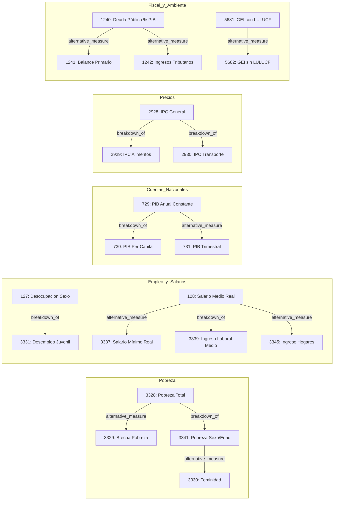

# Task 1 Report: Expand Metadata Registry & SQLite Store for 200-Question Indicators

- **Task ID:** Task 1
- **Developer:** Amelia (Senior Developer)
- **Base Commit:** `4afaa79729c8ee59fc48e22e3f3a8fb04e686e72`
- **Result Commit:** `d4dcaa0`
- **Status:** DONE

---

## 1. Summary of Changes

In Task 1, we expanded the CEPALSTAT semantic metadata registry and SQLite store to support the complete 25 official CEPALSTAT indicators required for the 200-question empirical benchmark suite. The implementation followed strict Test-Driven Development (TDD), ensuring that all newly registered indicators, measure types, units, dimensions, and typed relationships are available both in-memory and via SQLite persistence, while preserving 100% backward compatibility with existing tests.

### Key Components Updated:
1. **`src/statscepal/semantic/models.py`:**
   - Defined `MeasureType` enum covering all 25 indicator metrics including `INCIDENCIA_PORCENTUAL`, `BRECHA_PORCENTUAL`, `INDICE_FEMINIDAD`, `DISTRIBUCION_INGRESO`, `TASA_DESOCUPACION`, `INDICE_REAL`, `MONTO_MONEDA_LOCAL`, `USD_PER_CAPITA`, `TASA_VARIACION_INTERANUAL`, `INDICE_PRECIOS`, `PORCENTAJE_PIB`, `VOLUMEN_EMISIONES`, and `PORCENTAJE_GENERACION`.
2. **`src/statscepal/semantic/__init__.py`:**
   - Exported `MeasureType` in module `__all__`.
3. **`src/statscepal/semantic/registry.py`:**
   - Registered all 25 official indicators in `VERTICAL_SLICE_INDICATORS` with standardized names, concepts, measure types, units, and supported facets.
   - Defined `DEFAULT_OFFICIAL_DIMENSIONS` for multidimensional indicators.
   - Added `get_target_indicators(indicator_id, rel_type)` and `get_relationships(indicator_id)` to `SemanticRegistry` supporting both string and enum representations of `RelationshipType`.
   - Enhanced `get_indicator` to support fallback/dynamic retrieval from attached SQLite store (`CatalogStore`).
   - Maintained `"DESEMPLEO_JUVENIL": 3344` in `CONCEPT_CANONICAL_DEFAULTS` to ensure backward compatibility with legacy benchmark cases.
4. **`src/statscepal/catalog/store.py`:**
   - Added `indicator_metadata` table to `init_semantic_tables()`.
   - Added `store_indicator_metadata()`, `get_indicator_metadata()`, and `get_target_indicators()` methods to `CatalogStore`.
   - Implemented `populate_official_indicators()` to seed the SQLite tables with official metadata, typed relationships, and native dimensions/members.
5. **`tests/test_semantic_registry_200.py`:**
   - Created test suite asserting all 25 indicators exist with correct metadata, verifying all 13 typed relationships via `get_target_indicators` and `check_relationship`, and testing SQLite persistence and querying via `CatalogStore`.

---

## 2. Specification of 25 Official Registered Indicators

| ID | Indicator Name | Concept | Measure Type | Unit | Supported Facets |
| :---: | :--- | :--- | :--- | :--- | :--- |
| **3328** | Población en situación de pobreza extrema y pobreza, por área | `POBREZA` | `INCIDENCIA_PORCENTUAL` | `%` | `area`, `severidad` |
| **3341** | Tasa de incidencia de la pobreza según sexo y edad | `POBREZA` | `INCIDENCIA_PORCENTUAL` | `%` | `sexo`, `edad`, `area`, `severidad` |
| **3329** | Brecha de pobreza y pobreza extrema | `POBREZA_BRECHA` | `BRECHA_PORCENTUAL` | `%` | `area`, `severidad` |
| **3330** | Índice de feminidad de la pobreza | `POBREZA_FEMINIDAD` | `INDICE_FEMINIDAD` | `razón` | `sexo` |
| **3340** | Distribución del ingreso de los hogares por quintiles y deciles | `DISTRIBUCION_INGRESO` | `DISTRIBUCION_INGRESO` | `%` | `estrato`, `quintil`, `decil` |
| **127** | Tasa de desocupación por sexo | `EMPLEO` | `TASA_DESOCUPACION` | `%` | `sexo`, `formalidad` |
| **3331** | Tasa de desempleo juvenil de 15 a 24 años | `DESEMPLEO_JUVENIL` | `TASA_DESOCUPACION` | `%` | `sexo`, `edad` |
| **128** | Índice del salario medio real | `SALARIO_MEDIO` | `INDICE_REAL` | `índice 2018=100` | (none) |
| **3337** | Salario mínimo real | `SALARIO_MINIMO` | `INDICE_REAL` | `índice 2018=100` | `area`, `edad` |
| **3339** | Ingreso laboral medio de la población ocupada por sexo y área | `INGRESO_LABORAL` | `MONTO_MONEDA_LOCAL` | `moneda local` | `sexo`, `area` |
| **3345** | Ingreso medio per cápita de los hogares | `INGRESO_HOGARES` | `MONTO_MONEDA_LOCAL` | `moneda local` | `area` |
| **729** | Producto interno bruto total anual a precios constantes | `PIB` | `MONTO_MONEDA_LOCAL` | `millones moneda nacional` | (none) |
| **730** | Producto interno bruto per cápita a precios constantes | `PIB_PER_CAPITA` | `USD_PER_CAPITA` | `USD` | (none) |
| **731** | Producto interno bruto trimestral a precios constantes | `PIB_TRIMESTRAL` | `TASA_VARIACION_INTERANUAL` | `%` | (none) |
| **2928** | Índice de precios al consumidor (IPC) general | `IPC_GENERAL` | `INDICE_PRECIOS` | `índice 2018=100` | `rubro` |
| **2929** | Índice de precios al consumidor de alimentos y bebidas | `IPC_ALIMENTOS` | `INDICE_PRECIOS` | `índice 2018=100` | `canasta` |
| **2930** | Índice de precios al consumidor de transporte y energía | `IPC_TRANSPORTE_ENERGIA` | `INDICE_PRECIOS` | `índice 2018=100` | (none) |
| **1240** | Saldo de la deuda pública del gobierno central en porcentaje del PIB | `DEUDA_PUBLICA` | `PORCENTAJE_PIB` | `%` | (none) |
| **1241** | Balance primario del gobierno central en porcentaje del PIB | `BALANCE_PRIMARIO` | `PORCENTAJE_PIB` | `%` | (none) |
| **1242** | Ingresos tributarios del gobierno central en porcentaje del PIB | `INGRESOS_TRIBUTARIOS` | `PORCENTAJE_PIB` | `%` | (none) |
| **1243** | Saldo en cuenta corriente de la balanza de pagos en porcentaje del PIB | `CUENTA_CORRIENTE` | `PORCENTAJE_PIB` | `%` | (none) |
| **1244** | Términos de intercambio de bienes FOB/CIF | `TERMINOS_INTERCAMBIO` | `INDICE_PRECIOS` | `índice 2018=100` | (none) |
| **5681** | Emisiones totales de GEI incluyendo sector UTCUTS / con LULUCF | `EMISIONES_GEI_LULUCF` | `VOLUMEN_EMISIONES` | `Mt CO2 eq` | (none) |
| **5682** | Emisiones totales de GEI excluyendo sector UTCUTS / sin LULUCF` | `EMISIONES_GEI_SIN_LULUCF` | `VOLUMEN_EMISIONES` | `Mt CO2 eq` | (none) |
| **5683** | Participación de energías renovables en la generación eléctrica | `ENERGIA_RENOVABLE` | `PORCENTAJE_GENERACION` | `%` | (none) |

---

## 3. Typed Relationships Registered

The following typed substitution and alternative paths were registered and verified:



---

## 4. TDD Verification Evidence

### 4.1 RED Phase (Initial Failing Test Run)
```text
tests\test_semantic_registry_200.py FFF                                  [100%]
================================== FAILURES ===================================
__________________ test_registry_contains_all_25_indicators ___________________
    def test_registry_contains_all_25_indicators():
        ...
        for ind_id, expected in EXPECTED_25_INDICATORS.items():
            meta = registry.get_indicator(ind_id)
>           assert meta is not None, f"Indicator {ind_id} missing from SemanticRegistry"
E           AssertionError: Indicator 3329 missing from SemanticRegistry
________________ test_registry_typed_relationships_and_targets ________________
>       swaps_3328 = registry.get_target_indicators(3328, "breakdown_of")
E       AttributeError: 'SemanticRegistry' object has no attribute 'get_target_indicators'
_________ test_catalog_store_persists_25_indicators_and_relationships _________
>       store.populate_official_indicators()
E       AttributeError: 'CatalogStore' object has no attribute 'populate_official_indicators'
============================== 3 failed in 1.79s ==============================
```

### 4.2 GREEN Phase (Isolated Test Passing)
```text
collected 3 items
tests\test_semantic_registry_200.py ...                                  [100%]
============================== 3 passed in 3.63s ==============================
```

### 4.3 Full Non-Integration Test Suite Verification
```text
collected 171 items / 2 deselected / 169 selected
...
tests\test_semantic_benchmark.py ........                                [ 82%]
tests\test_semantic_fetcher.py ........                                  [ 86%]
tests\test_semantic_matcher.py .....                                     [ 89%]
tests\test_semantic_registry_200.py ...                                  [ 91%]
tests\test_semantic_store_relational.py .                                [ 92%]
...
===================== 169 passed, 2 deselected in 26.25s ======================
```

---

## 5. Git Status and Artifact Traceability

- **Branch:** `master`
- **Commit:** `d4dcaa0`
- **Commit Message:** `feat(semantic): register 25 official indicators and relationships for 200-question suite`
- **Files Modified/Created:**
  - `src/statscepal/semantic/models.py`
  - `src/statscepal/semantic/__init__.py`
  - `src/statscepal/semantic/registry.py`
  - `src/statscepal/catalog/store.py`
  - `tests/test_semantic_registry_200.py`
- **Cleanliness:** Working tree clean, zero stray files.
