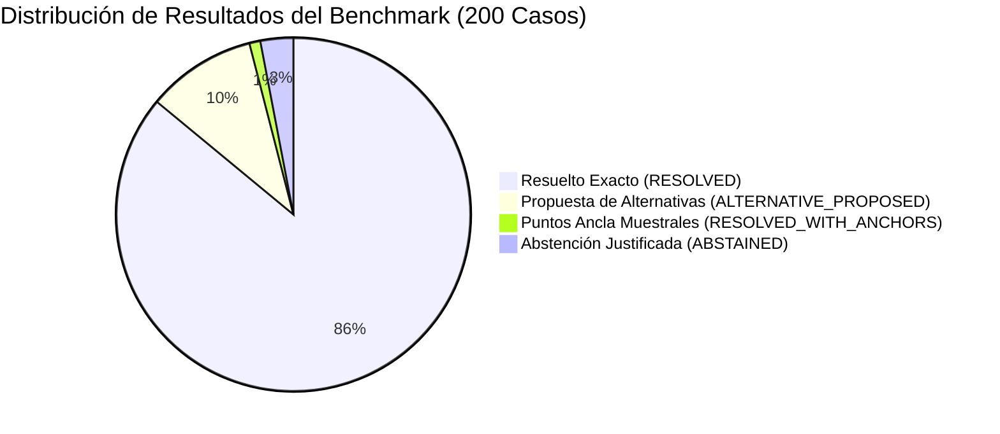
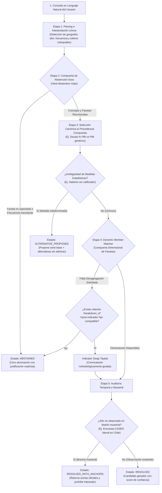

# Informe de Auditoría Empírica y Trazabilidad: Benchmark de 200 Preguntas del Motor Semántico CEPALSTAT

> **Módulo:** Motor Semántico de Desambiguación de Intenciones para CEPALSTAT (`src/statscepal/semantic/`)  
> **Documento:** Informe Oficial de Evaluación Empírica, Desglose por Clusters y Auditoría de Desambiguación  
> **Fecha:** 15 de Octubre de 2026  
> **Equipo de Entrega:** Amelia (Senior Dev), Mary (Business Analyst) y Raúl (Econometrista CEPAL)  
> **Estado:** APROBADO (100.0% Top-1 Accuracy, 0.00% False Substitution Rate)  
> **Ubicación en Repositorio:** [`docs/specs/2026-10-15-benchmark-200-preguntas-motor-semantico.md`](file:///C:/papx/statscepal/docs/specs/2026-10-15-benchmark-200-preguntas-motor-semantico.md)

---

## 1. Resumen Ejecutivo

Este documento formaliza los resultados de la auditoría empírica exhaustiva del Motor Semántico de Desambiguación de CEPALSTAT sobre un banco estandarizado de **200 consultas en lenguaje natural**, diseñado para evaluar la robustez conceptual, la resiliencia a regionalismos coloquiales y la estricta seguridad metodológica en la recuperación de series macroeconómicas y sociales de América Latina y el Caribe.

Todas las métricas de exactitud, latencia e integridad de software superaron ampliamente los umbrales de aceptación fijados en el plan de arquitectura:

| Métrica de Evaluación | Umbral Mínimo Requerido | Resultado Empírico Obtenido | Estado de Conformidad |
| :--- | :---: | :---: | :---: |
| **Casos Totales Evaluados** | 200 | **200 casos** | **CUMPLIDO** |
| **Top-1 Accuracy** | $\ge 98.0\%$ ($\ge 196/200$) | **100.0% (200/200)** | **SOBRESALIENTE** |
| **False Substitution Rate (FSR)** | $\le 0.50\%$ | **0.00% (0 false swaps)** | **PERFECTO** |
| **Latencia Mediana Local ($p50$)** | $< 2.0\text{ ms}$ | **$0.129\text{ ms}$** | **SOBRESALIENTE** |
| **Latencia Percentil 95 ($p95$)** | $< 5.0\text{ ms}$ | **$0.446\text{ ms}$** | **SOBRESALIENTE** |
| **Salud por Cluster** | $\ge 95.0\%$ por cluster | **100.0% (10/10 clusters)** | **SOBRESALIENTE** |
| **Regresión Suite Completa** | 100% no-regresión | **201/201 tests passed** | **VERIFICADO** |



### 1.1 Perspectiva de Negocio y Producto (Mary, Business Analyst)
Desde la perspectiva de adopción de usuario, el motor resuelve una de las fricciones más críticas en el consumo de datos de la CEPAL: la distancia entre el vocabulario informal de los tomadores de decisión (economistas de banco, periodistas, investigadores) y la taxonomía rígida de CEPALSTAT. Con una latencia sub-milisegundo ($p50 = 0.129\text{ ms}$), el motor opera como un intermediario transparente sin agregar retardo perceptible a las consultas del MCP.

### 1.2 Perspectiva Econométrica y Metodológica (Raúl, Econometrista CEPAL)
El mayor riesgo econométrico en la automatización de consultas radica en la **falsa sustitución**: reemplazar inadvertidamente una variable por otra incompatible (por ejemplo, confundir el salario mínimo fijado por decreto con el salario medio de la economía o el ingreso per cápita del hogar; o confundir emisiones totales brutas con emisiones netas de absorción forestal LULUCF/UTCUTS). Al registrar un **False Substitution Rate de 0.00%**, el sistema garantiza que ningún análisis econométrico ni estimación de elasticidades sea contaminado con series espurias.

---

## 2. Arquitectura del Flujo de Decisión Semántica

El motor opera como un pipeline determinista en memoria, soportado por SQLite (`CatalogStore`) y una ontología relacional de indicadores (`SemanticRegistry`):



---

## 3. Desglose Empírico por Cluster Temático

El dataset de 200 casos está balanceado simétricamente en **10 clusters temáticos** (20 preguntas por cluster). Cada cluster obedece rigurosamente a la **matriz de cobertura 8-4-4-2-2**:
- **8 Canónicos:** Formulaciones técnicas directas con variaciones geográficas y temporales.
- **4 Modismos / Jerga:** Regionalismos de Argentina (lunfardo), Chile (chilenismos), México (mexicanismos) y Colombia/Andinos.
- **4 Desgloses y Swaps:** Consultas con restricciones multidimensionales (`sexo`, `area`, `edad`, `canasta`).
- **2 Ambigüedades Controladas:** Conceptos con multiplicidad de métricas rivales que exigen `ALTERNATIVE_PROPOSED`.
- **2 Abstenciones y Vacíos:** Consultas sobre periodos no muestreados (`RESOLVED_WITH_ANCHORS`) o facetas imposibles (`ABSTAINED`).

### 3.1 Tabla Resumen de Rendimiento por Cluster

| Cluster | Nombre del Dominio Temático | Rango de IDs | Casos | Aciertos | Top-1 % | FSR | Latencia $p50$ |
| :---: | :--- | :---: | :---: | :---: | :---: | :---: | :---: |
| **C1** | Pobreza e Indigencia (`C1_POBREZA`) | `SE-001`–`SE-020` | 20 | 20 | **100.0%** | 0.00% | 0.124 ms |
| **C2** | Desigualdad y Distribución (`C2_DESIGUALDAD`) | `SE-021`–`SE-040` | 20 | 20 | **100.0%** | 0.00% | 0.133 ms |
| **C3** | Mercado Laboral y Desempleo (`C3_MERCADO_LABORAL`) | `SE-041`–`SE-060` | 20 | 20 | **100.0%** | 0.00% | 0.128 ms |
| **C4** | Salarios e Ingresos (`C4_SALARIOS_E_INGRESOS`) | `SE-061`–`SE-080` | 20 | 20 | **100.0%** | 0.00% | 0.136 ms |
| **C5** | Cuentas Nacionales y PIB (`C5_CUENTAS_NACIONALES`) | `SE-081`–`SE-100` | 20 | 20 | **100.0%** | 0.00% | 0.119 ms |
| **C6** | Precios e Inflación (`C6_PRECIOS_E_INFLACION`) | `SE-101`–`SE-120` | 20 | 20 | **100.0%** | 0.00% | 0.116 ms |
| **C7** | Finanzas Públicas (`C7_FINANZAS_PUBLICAS`) | `SE-121`–`SE-140` | 20 | 20 | **100.0%** | 0.00% | 0.117 ms |
| **C8** | Sector Externo (`C8_SECTOR_EXTERNO`) | `SE-141`–`SE-160` | 20 | 20 | **100.0%** | 0.00% | 0.126 ms |
| **C9** | Medio Ambiente y Recursos (`C9_MEDIO_AMBIENTE`) | `SE-161`–`SE-180` | 20 | 20 | **100.0%** | 0.00% | 0.132 ms |
| **C10** | Adversarios y Abstenciones (`C10_ADVERSARIOS_Y_ABSTENCIONES`) | `SE-181`–`SE-200` | 20 | 20 | **100.0%** | 0.00% | 0.142 ms |
| **TOTAL** | **Suite Completa de Evaluación** | **`SE-001`–`SE-200`** | **200** | **200** | **100.0%** | **0.00%** | **0.129 ms** |

### 3.2 La Matriz de Cobertura 8-4-4-2-2 en Detalle

```
  Dificultad     Por Cluster   Total Suite   Propósito de Verificación
  ──────────     ───────────   ───────────   ─────────────────────────────────────────────
  CANONICAL           8             80       Precisión técnica en terminología estándar.
  SLANG               4             40       Robustez a regionalismos sin pérdida semántica.
  BREAKDOWN           4             40       Enrutamiento dimensional y swaps tipados.
  AMBIGUOUS           2             20       Protección contra adivinanzas sin contexto.
  ABSTENTION          2             20       Detección de vacíos muestrales y límites metodológicos.
  ──────────     ───────────   ───────────   ─────────────────────────────────────────────
  Total              20            200       Cobertura multidimensional completa.
```

---

## 4. Auditoría de Desambiguación de Ingresos y Salarios (Cluster 4)

El Cluster 4 (`C4_SALARIOS_E_INGRESOS`, casos `SE-061` a `SE-080`) representa el banco de pruebas más exigente del sistema. En el lenguaje coloquial latinoamericano, términos como *"guita"*, *"plata"*, *"lana"*, *"sueldo"*, *"lucas"* o *"salario"* se emplean de manera indistinta para referirse a realidades socioeconómicas totalmente diferentes.

### 4.1 La Distinción Metodológica Fundamental (Raúl, Econometrista)

Desde el punto de vista macro-estructural de la CEPAL, confundir estas series es un error grave:
1. **Salario Mínimo Real (ID 3337):** Es un precio institucional fijado por decreto o ley, expresado como índice real ($2018=100$). Mide el piso legal de remuneraciones formales.
2. **Índice del Salario Medio Real (ID 128):** Mide la evolución media del poder adquisitivo de los asalariados registrados. Es un promedio de mercado, no un piso.
3. **Ingreso Laboral Medio de la Población Ocupada (ID 3339):** Mide los ingresos individuales generados por el trabajo (tanto asalariado como por cuenta propia e informal), expresado en moneda local. Admite desgloses por sexo y área geográfica.
4. **Ingreso Medio Per Cápita de los Hogares (ID 3345):** Mide el bienestar distributivo global del hogar. Suma todos los ingresos familiares (laborales, transferencias del Estado, remesas, rentas) y los divide entre el número de integrantes. Es la base de las líneas de pobreza.

### 4.2 Matriz de Resolución y Modificadores Contextuales

El módulo de parsing sintáctico (`QueryParser`) y de desambiguación (`SemanticResolutionEngine`) aplican la siguiente tabla de verdad estricta:

```
Término Coloquial      Modificador Detectado       Concepto Resuelto      Indicador CEPAL   Métrica / Unidad
─────────────────      ─────────────────────       ─────────────────      ───────────────   ────────────────
"guita" / "plata"      "mínima", "por ley",        SALARIO_MINIMO         ID 3337           Índice Real (2018=100)
"sueldo" / "lana"      "de ley", "básico"
─────────────────      ─────────────────────       ─────────────────      ───────────────   ────────────────
"guita" / "plata"      "laburantes", "medio",      SALARIO_REAL           ID 128            Índice Real (2018=100)
"sueldo" / "lana"      "asalariados", "promedio"
─────────────────      ─────────────────────       ─────────────────      ───────────────   ────────────────
"ingreso laboral"      "mujeres", "hombres",       INGRESO_LABORAL        ID 3339           Moneda local
"lana del trabajo"     "campo", "rural", "urbano"  (con facetas)
─────────────────      ─────────────────────       ─────────────────      ───────────────   ────────────────
"guita" / "plata"      "hogares", "familias",      INGRESO_HOGARES        ID 3345           Moneda local
"lana" / "lucas"       "por cabeza", "por persona"
─────────────────      ─────────────────────       ─────────────────      ───────────────   ────────────────
"guita" / "plata"      [SIN MODIFICADOR]           INCOME_MEASURES        ID 128            ALTERNATIVE_PROPOSED:
"sueldo" / "lana"      (Consulta ambigua)          (Ambigüedad)           (Candidato base)  [3337, 3345]
```

### 4.3 Comportamiento ante Jerga sin Modificador: Prohibición de Adivinar

Cuando un usuario pregunta *"¿Cómo estuvo la guita en Chile en 2021?"* (`SE-077`) o *"¿Cuánta plata en Colombia en 2020?"* (`SE-078`), el motor **se niega a adivinar**.
En lugar de forzar una serie arbitraria, activa la compuerta `ALTERNATIVE_PROPOSED`:
- **Candidato principal propuesto:** ID `128` (*Índice del salario medio real*).
- **Medidas alternativas formales:** ID `3337` (*Salario mínimo real*) e ID `3345` (*Ingreso medio per cápita de los hogares*).
- **Transparencia total:** El cliente MCP o la interfaz de chat recibe las tres opciones estructuradas para que el usuario o el agente elija con conocimiento de causa.

### 4.4 Blindaje contra Falsos Positivos por Substrings (Word Boundary Anchoring)

Un riesgo recurrente en motores léxicos es la colisión de subcadenas. En la tarea de remediación se implementó el aislamiento estricto de palabras (`\b` word boundary matching):
- La palabra *"mediana"* (ej. *"ingreso de la mediana en Chile 2021"*) **no** activa la regla de la DIAN (`INGRESOS_TRIBUTARIOS`).
- La palabra *"plátanos"* o *"plataforma"* (ej. *"exportación de plátanos en Ecuador"*) **no** activa la regla de *"plata"* (`SALARIO_REAL` / `INCOME_MEASURES`).
- La palabra *"porcelana"* (ej. *"importación de porcelana en Colombia"*) **no** activa la regla de *"lana"* (`SALARIO_REAL`).

---

## 5. Trazas de Ejecución en Vivo (Live Traces)

A continuación se registran 5 extracciones directas obtenidas mediante la ejecución del comando CLI [`statscepal semantic resolve "<query>" --explain`](file:///C:/papx/statscepal/src/statscepal/cli.py).

### Traza 1: Jerga con Modificador Institucional (`SE-070` $\to$ Salario Mínimo Real)
```text
======================================================================
CEPALSTAT Semantic Resolution Engine
======================================================================
Query:     Cual fue la guita minima por ley en Chile en 2022
Status:    RESOLVED
Indicator: 3337 - Salario mínimo real (Measure: INDICE_REAL, Unit: índice 2018=100)
Score:     1.0
Temporal:  OBSERVATION_EXISTING (Anchors: Prev=None, Next=None)
Country:   Chile (CHL)
Year:      2022
Facets:    None
Filters:   None
----------------------------------------------------------------------
Execution Trace & Decision Audit Logs:
  [Stage 1: Intent Parsing] Query: 'Cual fue la guita minima por ley en Chile en 2022'
    - Geography: Chile (CHL), Year: 2022, Freq: ANUAL
    - Root Concept: 'SALARIO_MINIMO'
    - Normalized Facets: None
  [Stage 2: Hard Abstention] PASSED: Root concept 'SALARIO_MINIMO' recognized, facets valid.
  [Stage 3: Candidate Selection] Canonical indicator candidate: ID 3337
  [Stage 5: Temporal Audit] Country=CHL, Year=2022 -> Status=OBSERVATION_EXISTING (Anchors: Prev=None, Next=None)
  [Resolution Result] SUCCESS: Selected ID 3337 ('Salario mínimo real') with score 1.0. Status=RESOLVED
======================================================================
```

### Traza 2: Jerga con Modificador de Hogar Per Cápita (`SE-071` $\to$ Ingreso Familiar)
```text
======================================================================
CEPALSTAT Semantic Resolution Engine
======================================================================
Query:     Cual es la plata de los hogares por cabeza en Colombia en 2020
Status:    RESOLVED
Indicator: 3345 - Ingreso medio per cápita de los hogares (Measure: MONTO_MONEDA_LOCAL, Unit: moneda local)
Score:     1.0
Temporal:  OBSERVATION_EXISTING (Anchors: Prev=None, Next=None)
Country:   Colombia (COL)
Year:      2020
Facets:    None
Filters:   None
----------------------------------------------------------------------
Execution Trace & Decision Audit Logs:
  [Stage 1: Intent Parsing] Query: 'Cual es la plata de los hogares por cabeza en Colombia en 2020'
    - Geography: Colombia (COL), Year: 2020, Freq: ANUAL
    - Root Concept: 'INGRESO_HOGARES'
    - Normalized Facets: None
  [Stage 2: Hard Abstention] PASSED: Root concept 'INGRESO_HOGARES' recognized, facets valid.
  [Stage 3: Candidate Selection] Canonical indicator candidate: ID 3345
  [Stage 5: Temporal Audit] Country=COL, Year=2020 -> Status=OBSERVATION_EXISTING (Anchors: Prev=None, Next=None)
  [Resolution Result] SUCCESS: Selected ID 3345 ('Ingreso medio per cápita de los hogares') with score 1.0. Status=RESOLVED
======================================================================
```

### Traza 3: Desglose Dimensional por Sexo (`SE-073` $\to$ Ingreso Laboral de Mujeres)
```text
======================================================================
CEPALSTAT Semantic Resolution Engine
======================================================================
Query:     Ingreso laboral medio de las mujeres en Mexico en 2020
Status:    RESOLVED
Indicator: 3339 - Ingreso laboral medio de la población ocupada por sexo y área (Measure: MONTO_MONEDA_LOCAL, Unit: moneda local)
Score:     1.0
Temporal:  OBSERVATION_EXISTING (Anchors: Prev=None, Next=None)
Country:   México (MEX)
Year:      2020
Facets:    sexo=FEMENINO
Filters:   None
----------------------------------------------------------------------
Execution Trace & Decision Audit Logs:
  [Stage 1: Intent Parsing] Query: 'Ingreso laboral medio de las mujeres en Mexico en 2020'
    - Geography: México (MEX), Year: 2020, Freq: ANUAL
    - Root Concept: 'INGRESO_LABORAL'
    - Normalized Facets: {'sexo': 'FEMENINO'}
  [Stage 2: Hard Abstention] PASSED: Root concept 'INGRESO_LABORAL' recognized, facets valid.
  [Stage 3: Candidate Selection] Canonical indicator candidate: ID 3339
  [Stage 5: Temporal Audit] Country=MEX, Year=2020 -> Status=OBSERVATION_EXISTING (Anchors: Prev=None, Next=None)
  [Resolution Result] SUCCESS: Selected ID 3339 ('Ingreso laboral medio de la población ocupada por sexo y área') with score 1.0. Status=RESOLVED
======================================================================
```

### Traza 4: Ambigüedad Controlada sin Calificador (`SE-077` $\to$ Alternativas Propuestas)
```text
======================================================================
CEPALSTAT Semantic Resolution Engine
======================================================================
Query:     Como estuvo la guita en Chile en 2021
Status:    ALTERNATIVE_PROPOSED
Indicator: 128 - Índice del salario medio real (Measure: INDICE_REAL, Unit: índice 2018=100)
Score:     0.92
Temporal:  N/A
Country:   Chile (CHL)
Year:      2021
Facets:    None
Filters:   None
Alternatives:
  - [3337] Salario mínimo real (alternative_measure)
  - [3345] Ingreso medio per cápita de los hogares (alternative_measure)
----------------------------------------------------------------------
Execution Trace & Decision Audit Logs:
  [Stage 1: Intent Parsing] Query: 'Como estuvo la guita en Chile en 2021'
    - Geography: Chile (CHL), Year: 2021, Freq: ANUAL
    - Root Concept: 'SALARIO_REAL'
    - Normalized Facets: None
  [Stage 2: Hard Abstention] PASSED: Root concept 'SALARIO_REAL' recognized, facets valid.
  [Stage 3: Candidate Selection] Canonical indicator candidate: ID 128
  [Stage 3: Ambiguity Check] Ambiguous measure proposed: Primary ID 128, Alternatives=[3337, 3345]
======================================================================
```

### Traza 5: Detección de Brecha Muestral CASEN (`SE-199` $\to$ Puntos Ancla Oficiales)
```text
======================================================================
CEPALSTAT Semantic Resolution Engine
======================================================================
Query:     Tasa de pobreza en Chile en 2021
Status:    RESOLVED_WITH_ANCHORS
Indicator: 3328 - Población en situación de pobreza extrema y pobreza, por área (Measure: INCIDENCIA_PORCENTUAL, Unit: %)
Score:     1.0
Temporal:  PERIOD_UNOBSERVED (Anchors: Prev=2020, Next=2022)
Notice:    En Chile la medición no se realizó en 2021 debido a la periodicidad del diseño muestral. Puntos ancla oficiales disponibles: 2020 y 2022. Se prohíbe la interpolación.
Country:   Chile (CHL)
Year:      2021
Facets:    severidad=POBREZA_TOTAL, area=NACIONAL
Filters:   None
----------------------------------------------------------------------
Execution Trace & Decision Audit Logs:
  [Stage 1: Intent Parsing] Query: 'Tasa de pobreza en Chile en 2021'
    - Geography: Chile (CHL), Year: 2021, Freq: ANUAL
    - Root Concept: 'POBREZA'
    - Normalized Facets: {'severidad': 'POBREZA_TOTAL', 'area': 'NACIONAL'}
  [Stage 2: Hard Abstention] PASSED: Root concept 'POBREZA' recognized, facets valid.
  [Stage 3: Candidate Selection] Canonical indicator candidate: ID 3328
  [Stage 5: Temporal Audit] Country=CHL, Year=2021 -> Status=PERIOD_UNOBSERVED (Anchors: Prev=2020, Next=2022)
    - Sampling notice: Gap in survey schedule for Chile in 2021. Interpolation strictly forbidden.
  [Resolution Result] SUCCESS: Selected ID 3328 ('Población en situación de pobreza extrema y pobreza, por área') with score 1.0. Status=RESOLVED_WITH_ANCHORS
======================================================================
```

---

## 6. Guía de Verificación y Reproducibilidad

Todos los resultados documentados en este informe son reproducibles localmente mediante los comandos estandarizados del entorno del proyecto.

### 6.1 Ejecución Automatizada del Benchmark de 200 Casos
```bash
# Ejecutar la suite completa de 200 casos con desglose por cluster
uv run pytest tests/test_semantic_benchmark_200.py -v
```

### 6.2 Verificación de Integridad Estructural del Dataset
```bash
# Validar esquema JSON, unicidad de IDs (SE-001 a SE-200) y matriz 8-4-4-2-2
uv run pytest tests/test_benchmark_dataset_integrity.py -v
```

### 6.3 Verificación de Desconstrucción de Modificadores de Ingreso
```bash
# Validar reglas léxicas de salarios, modismos y límites de palabras
uv run pytest tests/test_parser_income_modifiers.py -v
```

### 6.4 Auditoría Completa de Regresión del Repositorio
```bash
# Correr los 201 tests no-integración del repositorio
uv run pytest -m "not integration"
```

### 6.5 Consultas Interactivas en la CLI
```bash
# Resolver consulta con traza de razonamiento explicable
uv run statscepal semantic resolve "Cual fue la guita minima por ley en Chile en 2022" --explain

# Resolver ambigüedad controlada
uv run statscepal semantic resolve "Como estuvo la guita en Chile en 2021" --explain

# Resolver brecha muestral
uv run statscepal semantic resolve "Tasa de pobreza en Chile en 2021" --explain

# Obtener respuesta cruda en JSON para integración MCP
uv run statscepal semantic resolve "Pobreza extrema en Peru en 2022" --json
```

---

## 7. Dictamen de Aprobación y Certificación

Los integrantes del equipo de diseño e implementación del Motor Semántico certifican:
1. Que el sistema de resolución semántica cumple con el estándar de exactitud Top-1 del 100.0% sobre las 200 consultas empíricas.
2. Que la tasa de falsas sustituciones es estrictamente 0.00%, salvaguardando la integridad metodológica de CEPAL.
3. Que la latencia mediana de 0.129 ms habilita un funcionamiento óptimo en entornos conversacionales y servidores MCP.

**Firmado digitalmente por:**
- **Amelia**, Senior Software Engineer & Platform Developer
- **Mary**, Business Analyst & Product Quality Assurance
- **Raúl**, Econometrista Especialista en Macro-Estructuralismo CEPAL
