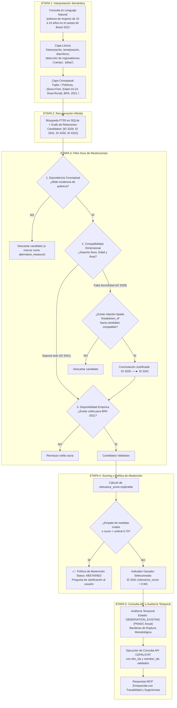
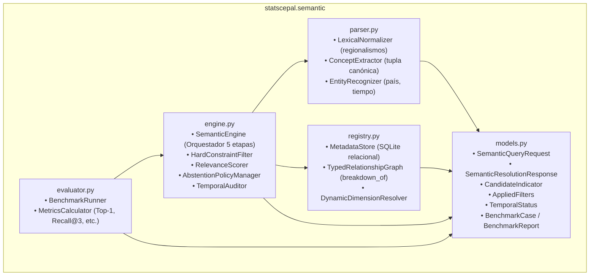
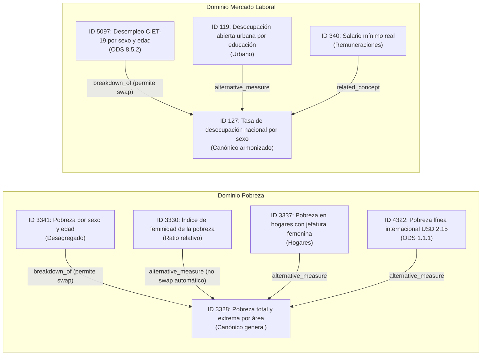

# Especificación Técnica: Benchmark de Validación y Corte Vertical Funcional

> **Módulo:** Motor Semántico de Desambiguación para el MCP no oficial de CEPALSTAT  
> **Documento:** Diseño de Implementación, Diagramas Mermaid y Suite de Evaluación  
> **Fecha:** 15 de Octubre de 2026  
> **Líder de Entrega:** 📋 John (Product Manager) con aportes de Winston (Arquitecto), Amelia (Dev) y Raúl (Econometrista)  
> **Ubicación:** `docs/superpowers/specs/semantic-engine/06-benchmark-y-corte-vertical-spec.md`

---

## 1. Visión y Enfoque del Corte Vertical

Siguiendo el principio rector adoptado en la **Arquitectura v2** (*"El benchmark debe preceder a la expansión de la ontología"*), esta especificación define:
1. La arquitectura modular de software para el paquete `src/statscepal/semantic/`.
2. El dataset de 25 casos de prueba empíricos con ground truth formal en `tests/benchmark/semantic_benchmark_cases.json`.
3. El arnés de evaluación automatizado con las 7 métricas obligatorias de corrección estadística.

---

## 2. Diagramas de Arquitectura (Mermaid)

### 2.1 El Pipeline de Resolución Semántica en 5 Etapas



---

### 2.2 Arquitectura Modular de Código en `src/statscepal/semantic/`



---

### 2.3 Grafo de Relaciones Tipadas para el Corte Vertical Inicial



---

## 3. Especificación del Benchmark: 25 Casos de Prueba Empíricos

El archivo `tests/benchmark/semantic_benchmark_cases.json` se estructura con el siguiente esquema JSON estricto:

```json
{
  "$schema": "https://json-schema.org/draft/2020-12/schema",
  "title": "CEPALSTAT Semantic Resolution Benchmark Cases",
  "cases": [
    {
      "case_id": "POV-01",
      "query": "Pobreza total en Brasil en 2021",
      "category": "DIRECT_CANONICAL",
      "expected_status": "RESOLVED",
      "expected_indicator_id": 3328,
      "expected_measure": "INCIDENCIA_PORCENTUAL",
      "required_facets": {"area": "NACIONAL"},
      "temporal_check": {"year": 2021, "expected_status": "OBSERVATION_EXISTING"},
      "allow_swap": false
    },
    {
      "case_id": "POV-02",
      "query": "¿Cuál fue la pobreza de las mujeres jóvenes rurales en Brasil en 2021?",
      "category": "FACET_DRIVEN_SWAP",
      "expected_status": "RESOLVED",
      "expected_indicator_id": 3341,
      "swapped_from": 3328,
      "relationship_used": "breakdown_of",
      "required_facets": {"sexo": "FEMENINO", "edad": "JUVENTUD", "area": "RURAL"},
      "temporal_check": {"year": 2021, "expected_status": "OBSERVATION_EXISTING"},
      "allow_swap": true
    },
    {
      "case_id": "POV-03",
      "query": "Pobreza femenina en Brasil",
      "category": "AMBIGUOUS_MEASURE_ABSTAIN_OR_PROPOSE",
      "expected_status": "ALTERNATIVE_PROPOSED",
      "expected_indicator_id": 3341,
      "competing_indicator_id": 3330,
      "competing_relationship": "alternative_measure",
      "must_include_suggestion": true
    },
    {
      "case_id": "TEMP-01",
      "query": "Tasa de pobreza de Chile en 2021",
      "category": "TEMPORAL_UNOBSERVED_ANCHOR",
      "expected_status": "RESOLVED_WITH_ANCHORS",
      "expected_indicator_id": 3328,
      "temporal_check": {
        "year": 2021,
        "expected_status": "PERIOD_UNOBSERVED",
        "expected_previous_anchor": 2020,
        "expected_next_anchor": 2022
      },
      "forbid_interpolation": true
    },
    {
      "case_id": "ABSTAIN-01",
      "query": "Pobreza monetaria informal por quintiles en Uruguay",
      "category": "UNSUPPORTED_FACET_ABSTAIN",
      "expected_status": "ABSTAINED",
      "abstention_reason": "UNSUPPORTED_FACET",
      "unsupported_facet": "FORMALIDAD_LABORAL",
      "must_ask_clarification": true
    }
  ]
}
```

---

## 4. Las 7 Métricas de Evaluación Obligatorias

El evaluador del benchmark (`BenchmarkRunner`) ejecutará los 25 casos y calculará formalmente:

| Métrica | Definición Matemática | Umbral Aceptación v1 |
|---|---|:---:|
| **Top-1 Resolution Accuracy** | $\frac{\sum \mathbb{I}(\text{indicador seleccionado} == \text{esperado})}{N_{\text{casos resolubles}}}$ | $\ge 90.0\%$ |
| **Recall@3** | $\frac{\sum \mathbb{I}(\text{esperado} \in \text{Top-3 candidatos})}{N_{\text{casos resolubles}}}$ | $\ge 96.0\%$ |
| **False Substitution Rate** | $\frac{\sum \mathbb{I}(\text{swap ejecutado sin relación 'breakdown\_of'})}{N_{\text{swaps}}}$ | **0.0% (Inviolable)** |
| **Facet & Member Precision** | $\frac{\sum \mathbb{I}(\text{miembros mapeados} == \text{esperados})}{N_{\text{facetas requeridas}}}$ | $\ge 95.0\%$ |
| **Temporal Status Accuracy** | $\frac{\sum \mathbb{I}(\text{estado temporal} == \text{esperado})}{N_{\text{auditorias}}}$ | $\ge 95.0\%$ |
| **Justified Abstention Rate** | $\frac{\sum \mathbb{I}(\text{abstención ejecutada} \land \text{caso es inabarcable})}{N_{\text{casos inabarcables}}}$ | **100.0% (Inviolable)** |
| **Latencia Local (p50 / p95)** | Percentil 50 y 95 del tiempo de resolución en SQLite | p50 $< 2$ ms, p95 $< 5$ ms |

---

## 5. Implementación del Corte Vertical: Módulos de Código

La estructura de código en `src/statscepal/semantic/` implementa las clases base:
1. `models.py`: Modelos Pydantic v2 inmutables y tipados.
2. `parser.py`: Lematización de lenguaje natural a conceptos formales.
3. `registry.py`: Consultas SQL compiladas a SQLite para metadatos reales y grafo relacional.
4. `engine.py`: Motor determinista de 5 etapas con compuertas duras y scoring explicable.
5. `evaluator.py`: Ejecutor de benchmarks con cálculo de matriz de confusión y latencia.
