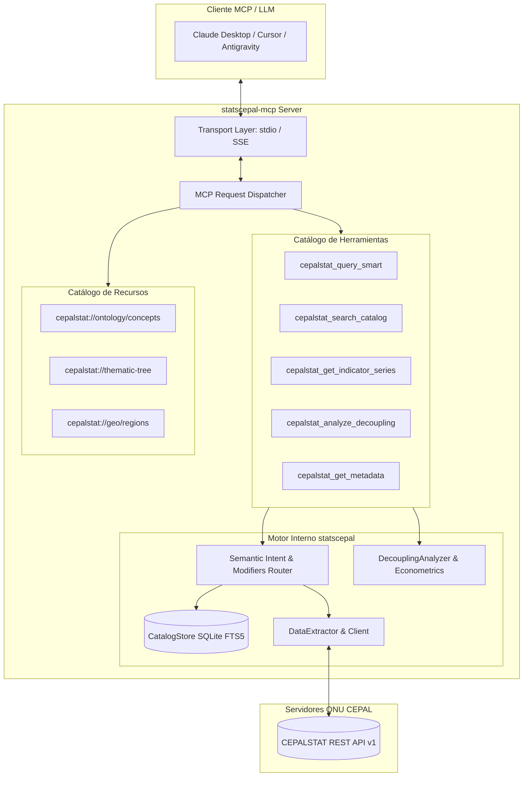

# Especificación Técnica de Arquitectura: Servidor MCP no oficial de CEPALSTAT (`statscepal-mcp`)
## Motor de Desambiguación Semántica, Ontología Económica Multidimensional y Protocolo MCP

- **Versión:** 1.0.0
- **Fecha:** 15 de octubre de 2026
- **Estado:** Especificación de Diseño Aprobada
- **Autoría:** Equipo BMAD (`statscepal`: Raúl, Winston, Amelia, Sally, Mary, John) & Discusión con Andrés Yáñez
- **Repositorio Base:** [`statscepal`](https://github.com/pcamacho447/statscepal)

---

## 1. Resumen Ejecutivo y Visión del Proyecto

El proyecto **`statscepal-mcp`** es una implementación del **Model Context Protocol (MCP)** diseñada para actuar como puente inteligente entre Modelos de Lenguaje Grande (LLMs como Claude, Gemini, ChatGPT) y el ecosistema de datos abiertos de la **Comisión Económica para América Latina y el Caribe (CEPAL / CEPALSTAT)**.

A diferencia de un cliente API tradicional o un simple wrapper de búsqueda textual, `statscepal-mcp` incorpora un **Motor de Desambiguación Semántica y Ontología Económica**. Este motor resuelve la fricción fundamental de las bases de datos estadísticas multilaterales: **la desconexión entre la pregunta informal del usuario en lenguaje natural y la hiper-especificidad dimensional de los datos oficiales**.

---

## 2. El Problema de Fondo: La Complejidad Oculta de CEPALSTAT

Cuando un usuario interactúa con un asistente de IA formulando preguntas como *"la pobreza en Brasil 2021"*, *"la pobreza femenina"* o *"el desempleo en Colombia"*, se enfrenta a la complejidad intrínseca de los cubos de datos multidimensionales:

### 2.1. La Trampa de las 99 Pobrezas
En el catálogo de CEPALSTAT existen **99 indicadores estadísticos diferentes** que contienen la palabra `pobreza`. Si un sistema realiza una búsqueda textual plana (TF-IDF o coincidencia de cadenas), el asistente se enfrenta a un dilema destructivo:
* **Colapso por interrogatorio:** Abruma al usuario preguntándole por 6 dimensiones antes de entregar ningún dato.
* **Falso positivo metodológico:** Devuelve el primer indicador indexado o confunde conceptos.

### 2.2. El "Picante" del Género: Tres Conceptos Radicalmente Distintos
Al preguntar por *"pobreza de mujeres"* o *"pobreza femenina"*, existen tres indicadores oficiales con interpretaciones económicas incompatibles:
1. **Tasa de Incidencia por Sexo (Indicador `3341`):** El porcentaje de mujeres bajo la línea de pobreza (ej. `29.8%`).
2. **Índice de Feminidad de la Pobreza (Indicador `3330`):** La relación de masculinidad inversa: cuántas mujeres pobres hay por cada 100 hombres pobres (ej. `114.5`). Confundir este ratio con una tasa porcentual destruye la credibilidad del análisis.
3. **Pobreza por Jefatura del Hogar (Indicador `3337`):** Incidencia de pobreza en hogares monoparentales encabezados por mujeres (ej. `34.2%`).

---

## 3. Matriz de Ontología Canónica: Los 5 Dominios Semánticos

Para gobernar el catálogo de CEPALSTAT sin fricción para el usuario, el servidor MCP implementa el principio de **«Respuesta Canónica Inmediata + Alternativas Estructuradas de Profundización»** (*Answer First, Clarify Next*).

El motor define cinco grandes **Dominios Canónicos** que concentran más del 80% de las consultas socioeconómicas en América Latina:

| Dominio | Intención Típica en Lenguaje Natural | Indicador Canónico Primario | Modificadores / Facetas Clave | Alternativas Estructuradas en Respuesta |
|---|---|:---:|---|---|
| **1. Pobreza e Inclusión** | *"pobreza", "indigencia", "línea de pobreza"* | **`3328`**<br>Población en situación de pobreza y pobreza extrema por área | `extrema`<br>`mujeres`<br>`hombres`<br>`infantil`<br>`rural`<br>`urbana`<br>`multidimensional` | • **`3341`**: Pobreza por sexo y edad.<br>• **`3330`**: Índice de feminidad (ratio M/H).<br>• **`3337`**: Pobreza en jefatura femenina.<br>• **`3332`**: Pobreza en niñez y adolescencia.<br>• **`5595`**: Pobreza multidimensional (IPM). |
| **2. Mercado Laboral** | *"desempleo", "desocupación", "empleo", "trabajo"* | **`2329`**<br>Tasa de desocupación por sexo y área | `juvenil`<br>`mujeres`<br>`informalidad`<br>`participación`<br>`urbana` | • **`2321`**: Tasa de participación en la fuerza de trabajo.<br>• **`2340`**: Empleo en sectores de baja productividad (informalidad estructural CEPAL).<br>• **`2342`**: Tasa de subocupación horaria. |
| **3. Crecimiento (PIB)** | *"pib", "crecimiento económico", "producto interno"* | **`3894`**<br>Tasa de crecimiento anual del PIB real per cápita | `total`<br>`per_capita`<br>`dolares`<br>`nominal`<br>`constante` | • **`2206`**: Tasa de crecimiento del PIB total a precios constantes.<br>• **`2199`**: PIB en dólares corrientes.<br>• **`2201`**: PIB por habitante a precios corrientes. |
| **4. Precios e Ingresos** | *"inflación", "salarios", "costo de vida", "canasta básica"* | **`340`** (Salario Mínimo Real)<br>**`2929`** (Inflación Alimentos) | `alimentos`<br>`minimo`<br>`medio`<br>`canasta`<br>`brecha` | • **`2928`**: Variación acumulada del IPC general.<br>• **`3333`**: Valor de las líneas de pobreza en moneda local.<br>• **`food_wage_gap`**: Brecha Salario Real vs Inflación de Alimentos. |
| **5. Desigualdad** | *"gini", "desigualdad", "distribución del ingreso"* | **`3289`**<br>Coeficiente de Gini de distribución del ingreso | `quintiles`<br>`palma`<br>`brecha_genero` | • **`3290`**: Participación del ingreso por quintiles (Ratio 20/20).<br>• **`3291`**: Ratio de Palma (Decil 10 / Deciles 1-4). |

---

## 4. Resolvedor de Entidades Coloquiales: Geografía y Tiempo

Los usuarios rara vez escriben *"código de miembro 218 y año 2021"*. El servidor MCP incorpora traductores automáticos para expresiones coloquiales comunes:

### 4.1. Agregados Geográficos y Bloques Regionales
* **`América Latina` / `ALC`:** Resuelve automáticamente al Member ID oficial de la CEPAL (`208: Total América Latina`) o calcula el agregado ponderado de los 18 países principales.
* **`Cono Sur`:** Resuelve a `[Argentina, Chile, Uruguay, Paraguay, Brasil]`.
* **`Comunidad Andina` / `Países Andinos`:** Resuelve a `[Colombia, Perú, Ecuador, Bolivia]`.
* **`Alianza del Pacífico`:** Resuelve a `[Chile, Colombia, México, Perú]`.
* **`Mercosur`:** Resuelve a `[Argentina, Brasil, Paraguay, Uruguay]`.
* **Normalización de Nombres:** Acepta sinónimos internacionales y acentos (`Brazil` $\to$ `Brasil`, `México` $\to$ `Mexico`, `República Dominicana` $\to$ `Dominican Republic`).

### 4.2. Ventanas Temporales Simbólicas
* **`pre-pandemia`:** Mapea automáticamente al quinquenio `2015–2019`.
* **`pandemia`:** Mapea al año de choque `2020`.
* **`post-pandemia`:** Mapea al trienio de recuperación e inflación `2021–2023` (o el último dato disponible).
* **`últimos 5 años` / `última década`:** Resuelve dinámicamente:
  $$[A\tilde{n}o_{\text{actual}} - 5, A\tilde{n}o_{\text{actual}}] \quad \text{o} \quad [A\tilde{n}o_{\text{actual}} - 10, A\tilde{n}o_{\text{actual}}]$$
* **Ciclos de Gobierno Presidencial:** Mapea nombres de mandatarios a sus periodos de mandato exactos (ej. *AMLO* $\to$ México 2018–2024; *Lula* $\to$ Brasil 2023–2026; *Milei* $\to$ Argentina 2024–presente).

---

## 5. Arquitectura del Servidor MCP (`statscepal-mcp`)

El protocolo **Model Context Protocol (MCP)** se implementa utilizando la biblioteca oficial `mcp` para Python, con soporte de transporte dual:
1. **`stdio` (Estándar):** Comunicación local por entrada/salida estándar para Claude Desktop, Cursor y terminales locales.
2. **`sse` (Server-Sent Events):** Comunicación HTTP orientada a microservicios en la nube y contenedores Docker.



---

## 6. Especificación de Herramientas (*Tools*)

### 6.1. Herramienta Principal: `cepalstat_query_smart`

#### JSON-Schema del Tool:
```json
{
  "name": "cepalstat_query_smart",
  "description": "Consulta inteligente de estadísticas oficiales de CEPALSTAT. Resuelve lenguaje natural (pobreza, desempleo, PIB, inflación, salario mínimo, gini), desambigua dimensiones complejas (área, género, grupos de edad, metodologías) y devuelve el dato canónico oficial junto con alternativas estructuradas de refinamiento.",
  "parameters": {
    "type": "object",
    "properties": {
      "concept": {
        "type": "string",
        "description": "Concepto socioeconómico (ej. 'pobreza', 'pobreza femenina', 'desempleo', 'pib', 'inflacion alimentos', 'salario real', 'gini')"
      },
      "country": {
        "type": "string",
        "description": "Nombre del país o bloque regional (ej. 'Brasil', 'México', 'América Latina', 'Cono Sur')"
      },
      "year": {
        "type": "integer",
        "description": "Año específico (ej. 2021) o null para el dato más reciente disponible"
      },
      "facet": {
        "type": "string",
        "enum": [
          "total",
          "mujeres",
          "hombres",
          "juvenil",
          "rural",
          "urbana",
          "infantil",
          "jefatura_femenina",
          "indice_feminidad",
          "extrema",
          "informalidad"
        ],
        "description": "Faceta específica opcional para filtrar explícitamente"
      }
    },
    "required": ["concept", "country"]
  }
}
```

#### Estructura de Respuesta JSON:
```json
{
  "status": "success",
  "primary_result": {
    "indicator_id": 3341,
    "indicator_name": "Población en situación de pobreza extrema y pobreza, por sexo, grupo de edad y área",
    "country": "Brasil",
    "year": 2021,
    "value": 29.8,
    "unit": "% de la población femenina",
    "dimensions_applied": {
      "sexo": "Mujeres",
      "area": "Nacional",
      "grupo_edad": "Total",
      "situacion": "Pobreza"
    },
    "methodological_note": "Fuente: CEPALSTAT sobre la base de microdatos de la PNAD continua (IBGE)."
  },
  "disambiguation_context": {
    "interpreted_as": "Incidencia de pobreza en la población femenina (tasa de pobreza en mujeres)",
    "related_indicators": [
      {
        "indicator_id": 3330,
        "name": "Índice de feminidad de la pobreza",
        "value": 114.5,
        "unit": "Mujeres pobres por cada 100 hombres pobres",
        "when_to_use": "Usa este dato si buscas la sobrerrepresentación relativa de mujeres frente a hombres en la pobreza."
      },
      {
        "indicator_id": 3337,
        "name": "Pobreza en hogares con jefatura femenina",
        "value": 34.2,
        "unit": "% de hogares con jefa de hogar mujer",
        "when_to_use": "Usa este dato si la consulta alude a hogares monoparentales encabezados por mujeres."
      }
    ]
  }
}
```

---

### 6.2. `cepalstat_search_catalog`
Permite búsquedas libres indexadas en los más de 2,000 indicadores del catálogo maestro mediante búsqueda de texto completo SQLite FTS5.
* **Parámetros:** `query: str`, `thematic_area: str | None`, `limit: int = 15`.

### 6.3. `cepalstat_get_indicator_series`
Descarga la serie histórica completa de un indicador para análisis comparativo entre múltiples países y periodos.
* **Parámetros:** `indicator_id: int`, `countries: list[str]`, `start_year: int`, `end_year: int`.

### 6.4. `cepalstat_analyze_decoupling`
Ejecuta el motor analítico de desacople bienestar-crecimiento y el modelo econométrico multivariado OLS con `statsmodels`.
* **Parámetros:** `countries: list[str]`, `periods: list[tuple]`, `include_econometrics: bool = True`.

### 6.5. `cepalstat_get_metadata`
Retorna la ficha metodológica oficial de un indicador (fuentes primarias, encuesta de hogares de origen, notas de comparabilidad internacional).
* **Parámetros:** `indicator_id: int`.

---

## 7. Estructura del Código en Python (`src/statscepal/mcp/`)

```text
src/statscepal/
├── analysis/              # Motor econométrico y desacople
├── bitacora/              # Bitácoras metodológicas
├── catalog/               # CatalogStore SQLite FTS5 y ThematicTree
├── mcp/                   # Paquete del Servidor MCP
│   ├── __init__.py        # Exposición de Server y CLI entrypoint
│   ├── ontology.py        # Diccionario CANONICAL_DOMAINS y reglas semánticas
│   ├── resolver.py        # Resolvedor de entidades geográficas y temporales
│   ├── tools.py           # Definición e implementación de los 5 Tools
│   ├── resources.py       # Exposición de Resources estáticos
│   └── server.py          # Servidor principal FastMCP / mcp.server.stdio
```

---

## 8. Guía de Configuración con Clientes MCP

### 8.1. Configuración para Claude Desktop (`claude_desktop_config.json`)
```json
{
  "mcpServers": {
    "cepalstat": {
      "command": "uv",
      "args": [
        "--directory",
        "C:\\Users\\camac\\.herdr\\worktrees\\statscepal\\worktree-quiet-harbor-46a5",
        "run",
        "statscepal",
        "mcp",
        "run"
      ]
    }
  }
}
```

### 8.2. Comando de Lanzamiento por CLI:
```bash
uv run statscepal mcp run
```

---

## 9. Próximos Pasos de Implementación

1. **Sprint 1 (Ontología y Resolvedor):** Implementar `ontology.py` y `resolver.py` con pruebas unitarias exhaustivas en `tests/test_mcp_ontology.py`.
2. **Sprint 2 (Servidor MCP y Tools):** Implementar `tools.py` y `server.py` utilizando `mcp.server.fastmcp`.
3. **Sprint 3 (Integración CLI y Documentación de Usuario):** Añadir el subcomando `statscepal mcp run` a `cli.py` y actualizar el `README.md` del repositorio.
