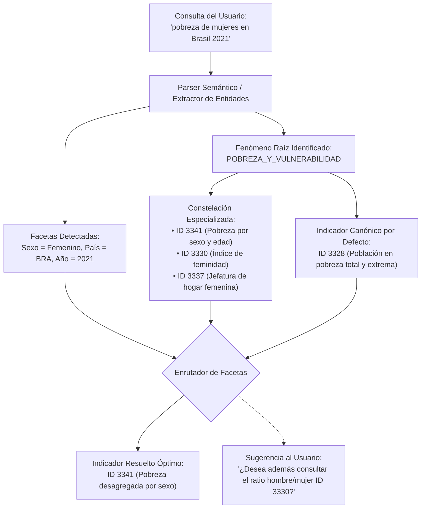

# Sesión 1: Taxonomía de los 25 Fenómenos Raíz Universales de CEPALSTAT

> **Módulo:** Motor Semántico de Desambiguación para el MCP no oficial de CEPALSTAT  
> **Documento:** Especificación Arquitectónica y Ontológica — Pilar 1 de 4  
> **Fecha:** Octubre 2026  
> **Ámbito:** Catálogo completo de 2,143+ indicadores de la Comisión Económica para América Latina y el Caribe (CEPAL / ECLAC)  
> **Autores / Panel BMAD:** Raúl Prebisch (Econometrista Macro-estructuralista), Winston (Arquitecto de Sistemas), Amelia (Senior Dev), Sally (UX/AI Interaction), Mary (Analista de Datos y Negocio), John (Product Manager).

---

## 1. Justificación y Fundamentación del Problema

### 1.1 La Trampa del "Juguete de 5 Indicadores"
En implementaciones preliminares de clientes de datos, es común caer en la simplificación de mapear de forma fija (*hardcoded*) un puñado arbitrario de series (por ejemplo, PIB `2203`, Desempleo `127`, Pobreza `3328`, Inflación de alimentos `2929` y Salario mínimo `340`). Si bien esto permite demostraciones rápidas, convierte al servidor MCP en una herramienta ciega para los investigadores, econometristas y tomadores de decisiones de la región, quienes acuden a CEPALSTAT buscando respuestas a preguntas matizadas:

- *"¿Cómo ha variado la brecha de género en el salario urbano en el Cono Sur?"*
- *"Dame la tasa de desempleo juvenil de mujeres rurales en Centroamérica"*
- *"Compara las emisiones netas con y sin cambio de uso de suelo (LULUCF) en la Cuenca Amazónica"*
- *"¿Cuál es la proporción de la deuda sobre el PIB versus la deuda en moneda extranjera?"*

### 1.2 La Explosión Combinatoria en CEPALSTAT
CEPALSTAT contiene **2,143 indicadores** distribuidos en 4 áreas temáticas oficiales (*Sociales y Demográficos*, *Económicos*, *Ambientales*, *Temas Transversales / ODS*).
Cuando un usuario consulta un término aparentemente simple como **"pobreza"**, la búsqueda textual ingenua (*naive LIKE*) colapsa porque existen **99 indicadores que contienen la palabra "pobreza"**. Entre ellos encontramos:
- `3328`: *Población en situación de pobreza extrema y pobreza, por área* (% y miles de personas).
- `3330`: *Índice de feminidad de la pobreza* (número de mujeres pobres por cada 100 hombres pobres).
- `3341`: *Tasa de incidencia de la pobreza según sexo y edad*.
- `3337`: *Pobreza en hogares con jefatura femenina*.
- `2656`: *Tiempo de trabajo no remunerado según condición de pobreza*.
- `4322`: *Indicador ODS 1.1.1 — Población bajo la línea internacional de pobreza*.

Si un agente LLM no comprende la diferencia ontológica entre el **Fenómeno Raíz** (la condición socioeconómica subyacente) y las **Facetas Métricas** (el numerador, denominador, población objetivo y desagregación), terminará entregando una respuesta científicamente inválida.

### 1.3 Principio Arquitectónico del Motor Semántico
> **"El usuario declara el fenómeno y sus matices en lenguaje natural libre; la ontología identifica de inmediato el Fenómeno Raíz Universal y enruta la consulta hacia un Indicador Canónico por Omisión, preservando la constelación de indicadores especializados como opciones de refinamiento."**



---

## 2. Taxonomía de los 25 Fenómenos Raíz Universales

Para organizar el universo de los 2,143 indicadores de CEPALSTAT de forma exhaustiva y determinista, definimos **25 Fenómenos Raíz Universales** agrupados en cuatro ejes temáticos fundamentales:

```
├── EJE I: Demografía, Sociedad y Bienestar Humano (8 Fenómenos)
├── EJE II: Macroeconómico, Precios y Cuentas Nacionales (8 Fenómenos)
├── EJE III: Género, Derechos, Seguridad y Cohesión (4 Fenómenos)
└── EJE IV: Medio Ambiente, Clima, Energía y Territorio (5 Fenómenos)
```

---

### EJE I: Demografía, Sociedad y Bienestar Humano

#### 1. `POBREZA_Y_VULNERABILIDAD`
- **Definición:** Medición de la población cuyos ingresos o capacidades no alcanzan los umbrales mínimos normativos (líneas de pobreza y pobreza extrema / indigencia calculadas por CEPAL con metodología de canasta básica de alimentos y no alimentos).
- **Indicador Canónico por Omisión:** `3328` — *Población en situación de pobreza extrema y pobreza, por área*.
- **Constelación de Indicadores Especializados:**
  - `3341`: Pobreza según sexo y grupos de edad.
  - `3330`: Índice de feminidad de la pobreza.
  - `3337`: Pobreza en hogares con jefatura femenina.
  - `4322`: Población por debajo de la línea internacional de pobreza (ODS 1.1.1).
  - `2656`: Tiempo de trabajo no remunerado según condición de pobreza.
- **Tokens Clave en Lenguaje Natural:** `pobreza`, `indigencia`, `pobreza extrema`, `pobres`, `línea de pobreza`, `vulnerabilidad económica`, `bajo la línea`.

#### 2. `DISTRIBUCION_INGRESO_Y_DESIGUALDAD`
- **Definición:** Métricas de concentración, dispersión y estratificación del ingreso disponible de los hogares y las personas.
- **Indicador Canónico por Omisión:** `3289` — *Índice de Gini de concentración del ingreso*.
- **Constelación de Indicadores Especializados:**
  - `4357`: Impacto redistributivo de la política fiscal en el índice de Gini (ODS 10.4.2).
  - Distribución del ingreso por quintiles y deciles (participación del 10% más rico vs. 40% más pobre).
  - Ratios Palma (Decil 10 / Deciles 1-4).
- **Tokens Clave en Lenguaje Natural:** `gini`, `desigualdad`, `concentracion del ingreso`, `brecha ricos pobres`, `palma`, `quintil`, `decil`.

#### 3. `EMPLEO_Y_MERCADO_LABORAL`
- **Definición:** Dinámica del factor trabajo: participación, ocupación, subempleo, desocupación abierta y condiciones de informalidad.
- **Indicador Canónico por Omisión:** `127` — *Tasa de desocupación por sexo*.
- **Constelación de Indicadores Especializados:**
  - `5097`: Tasa de desempleo desglosada por sexo y edad según estándares CIET-19 (ODS 8.5.2).
  - `119`: Tasa de desocupación abierta en el área urbana por sexo y años de educación.
  - `4041`: Tasa de desempleo según área geográfica (rural/urbana).
  - Tasas de participación laboral y ocupación formal vs. informal.
- **Tokens Clave en Lenguaje Natural:** `desempleo`, `desocupacion`, `paro`, `tasa de desempleo`, `empleo`, `ocupacion`, `tasa de participacion`, `informalidad laboral`, `cuenta propia`.

#### 4. `SALARIOS_Y_REMUNERACIONES`
- **Definición:** Retribución monetaria y real del factor trabajo, poder adquisitivo de los ingresos laborales y pisos salariales normativos.
- **Indicador Canónico por Omisión:** `340` — *Salario mínimo real*.
- **Constelación de Indicadores Especializados:**
  - `3140`: Salario mínimo agrícola.
  - `149`: Relación de salarios urbanos entre mujeres y hombres por años de estudio (brecha salarial).
  - Índices de remuneración media real.
- **Tokens Clave en Lenguaje Natural:** `salario`, `sueldo`, `salario minimo`, `remuneraciones`, `sueldo basico`, `ingreso laboral`, `salario real`, `brecha salarial`.

#### 5. `EDUCACION_Y_CAPITAL_HUMANO`
- **Definición:** Acceso, progresión, permanencia y logros en el sistema formativo, así como capacidades básicas de alfabetización de la población.
- **Indicador Canónico por Omisión:** `53` — *Tasa de analfabetismo por sexo, grupo de edad y área*.
- **Constelación de Indicadores Especializados:**
  - `144`: Asistencia escolar masculina y femenina por grupo de edad, quintiles y área.
  - `4203`: Recursos destinados a becas de educación superior y técnica (ODS 4.b.1).
  - Tasas de conclusión de educación primaria, secundaria y terciaria.
  - Años promedio de escolaridad de la población económicamente activa.
- **Tokens Clave en Lenguaje Natural:** `educacion`, `analfabetismo`, `escolaridad`, `matricula`, `asistencia escolar`, `graduacion secundaria`, `universidad`, `estudiantes`.

#### 6. `SALUD_Y_PROTECCION_SOCIAL`
- **Definición:** Estado biomédico de la población, esperanza de vida, morbilidad, coberturas sanitarias y sistemas de seguridad social.
- **Indicador Canónico por Omisión:** `4784` — *Esperanza de vida al nacer, según sexo*.
- **Constelación de Indicadores Especializados:**
  - `4405`: Gasto social público y privado en salud y protección social (metodología SOCX).
  - `4192`: Cobertura de tratamientos sanitarios y programas de salud pública (ODS 3.5.1).
  - Tasas de mortalidad infantil y materna por 1,000 / 100,000 nacidos vivos.
- **Tokens Clave en Lenguaje Natural:** `salud`, `esperanza de vida`, `mortalidad infantil`, `mortalidad materna`, `camas de hospital`, `gasto en salud`, `cobertura medica`, `vacunacion`.

#### 7. `VIVIENDA_Y_SERVICIOS_BASICOS`
- **Definición:** Calidad del hábitat residencial, tenencia de la vivienda, hacinamiento y acceso a infraestructura esencial domiciliaria (agua potable, saneamiento, electricidad).
- **Indicador Canónico por Omisión:** *Población con acceso a servicios de agua potable gestionados de forma segura*.
- **Constelación de Indicadores Especializados:**
  - Acceso a redes de saneamiento y alcantarillado.
  - Hogares en condiciones de hacinamiento crítico (>3 personas por cuarto).
  - Materialidad precaria de paredes, techos o pisos.
- **Tokens Clave en Lenguaje Natural:** `vivienda`, `deficit habitacional`, `agua potable`, `saneamiento`, `cloacas`, `hacinamiento`, `servicios basicos`, `techo digno`.

#### 8. `DEMOGRAFIA_Y_DINAMICA_POBLACIONAL`
- **Definición:** Estructura, volumen, crecimiento, transición demográfica, fecundidad y patrones migratorios de los países.
- **Indicador Canónico por Omisión:** `1` — *Población total, según sexo*.
- **Constelación de Indicadores Especializados:**
  - Pirámides poblacionales por tramos de edad quinquenales.
  - Tasa global de fecundidad (hijos por mujer).
  - Tasa de crecimiento demográfico y saldos migratorios netos.
- **Tokens Clave en Lenguaje Natural:** `poblacion`, `habitantes`, `censo`, `demografia`, `fecundidad`, `migracion`, `envejecimiento`, `tasa de natalidad`.

---

### EJE II: Macroeconómico, Precios y Cuentas Nacionales

#### 9. `CRECIMIENTO_Y_PIB`
- **Definición:** Magnitud y variación de la producción agregada de bienes y servicios finales valorados a precios constantes y corrientes.
- **Indicador Canónico por Omisión:** `2203` — *Producto interno bruto (PIB) anual a precios constantes en dólares*.
- **Constelación de Indicadores Especializados:**
  - PIB per cápita a precios constantes y corrientes.
  - PIB trimestral desestacionalizado y tasas de variación interanual.
  - `4211`: Valor añadido del sector manufacturero per cápita / proporción del PIB (ODS 9.2.1).
  - Componentes del gasto agregado: Consumo de hogares, Inversión (FBKF), Gasto de gobierno.
- **Tokens Clave en Lenguaje Natural:** `pib`, `producto interno bruto`, `crecimiento economico`, `gdp`, `actividad economica`, `recesion`, `produccion nacional`.

#### 10. `PRECIOS_E_INFLACION_GENERAL`
- **Definición:** Variación sistemática del nivel general de precios al consumidor y al productor, y erosión del poder de compra de la moneda local.
- **Indicador Canónico por Omisión:** `365` — *Índice de precios al consumidor (IPC)*.
- **Constelación de Indicadores Especializados:**
  - Variación porcentual interanual y mensual del IPC nacional.
  - Índices de precios al productor (IPP) e índices de paridad de poder adquisitivo (PPA).
- **Tokens Clave en Lenguaje Natural:** `inflacion`, `ipc`, `precios`, `costo de vida`, `variacion de precios`, `inflacion interanual`.

#### 11. `INFLACION_DE_ALIMENTOS`
- **Definición:** Variación específica de la canasta de alimentos y bebidas no alcohólicas, determinante crítico de la línea de indigencia y el salario real.
- **Indicador Canónico por Omisión:** `2929` — *Variación a doce meses del índice de precios al consumidor, alimentos y bebidas (%)*.
- **Constelación de Indicadores Especializados:**
  - `1684`: Índice de precios al consumidor, alimentos y bebidas (nivel de índice base).
  - Subíndices de cereales, carnes, lácteos y aceites.
- **Tokens Clave en Lenguaje Natural:** `inflacion de alimentos`, `precio de los alimentos`, `canasta alimentaria`, `carestia de comida`, `ipc alimentos`.

#### 12. `COMERCIO_EXTERIOR_Y_EXPORTACIONES`
- **Definición:** Intercambio transfronterizo de mercancías y servicios: volúmenes, valores FOB/CIF, concentración por productos y términos de intercambio.
- **Indicador Canónico por Omisión:** `2949` — *América Latina y el Caribe: Exportación de los 10 productos principales conforme a la CUCI rev.4*.
- **Constelación de Indicadores Especializados:**
  - `4548`: Crecimiento anual de las exportaciones de bienes y servicios (%) (ODS 17.13.1).
  - `4073`: Promedio arancelario mundial ponderado y aranceles efectivos (ODS 17.10.1).
  - Índice de términos de intercambio de bienes (relación de precios export/import).
- **Tokens Clave en Lenguaje Natural:** `exportaciones`, `importaciones`, `comercio exterior`, `balanza comercial`, `aranceles`, `terminos de intercambio`, `ventas externas`.

#### 13. `BALANZA_DE_PAGOS_Y_SECTOR_EXTERNO`
- **Definición:** Registro de todas las transacciones económicas reales y financieras entre un país y el resto del mundo, y posición de liquidez internacional.
- **Indicador Canónico por Omisión:** `740` — *Saldo en cuenta corriente como porcentaje del producto interno bruto*.
- **Constelación de Indicadores Especializados:**
  - `4542`: Saldo de la cuenta corriente como proporción del PIB (%) (ODS 17.13.1).
  - Reservas internacionales brutas y netas (meses de importación).
  - Renta de factores y transferencias corrientes netas (remesas familiares).
- **Tokens Clave en Lenguaje Natural:** `balanza de pagos`, `cuenta corriente`, `reservas internacionales`, `sector externo`, `remesas`, `deficit externo`.

#### 14. `INVERSION_EXTRANJERA_DIRECTA`
- **Definición:** Flujos y acervos de capital productivo transfronterizo con control societario a largo plazo en la economía receptora.
- **Indicador Canónico por Omisión:** `4231` — *Entradas de inversión extranjera directa (IED) en millones de dólares*.
- **Constelación de Indicadores Especializados:**
  - `4541`: Inversión extranjera directa, entradas netas como proporción del PIB (%) (ODS 17.13.1).
  - IED por sector de destino (recursos naturales, manufacturas, servicios).
- **Tokens Clave en Lenguaje Natural:** `inversion extranjera`, `ied`, `fdi`, `capital extranjero`, `inversion transnacional`.

#### 15. `SECTOR_PUBLICO_Y_FISCAL`
- **Definición:** Cuentas fiscales del gobierno general: ingresos tributarios, gasto corriente y de capital, y balances presupuestarios primario y global.
- **Indicador Canónico por Omisión:** *Ingresos tributarios del gobierno central como porcentaje del PIB*.
- **Constelación de Indicadores Especializados:**
  - Balance primario y balance económico como % del PIB.
  - Estructura de ingresos tributarios: impuestos directos (renta) vs. indirectos (IVA).
  - `4405`: Gasto social público y privado (metodología SOCX).
- **Tokens Clave en Lenguaje Natural:** `sector publico`, `fiscal`, `gasto publico`, `ingresos tributarios`, `impuestos`, `deficit fiscal`, `superavit primario`.

#### 16. `DEUDA_PUBLICA_Y_EXTERNA`
- **Definición:** Acervo de obligaciones contractuales de deuda interna y externa asumidas por el sector público y privado frente a acreedores residentes y no residentes.
- **Indicador Canónico por Omisión:** `1240` — *Saldo de la deuda pública en porcentajes del PIB*.
- **Constelación de Indicadores Especializados:**
  - `1239`: Saldo de la deuda pública en millones de dólares estadounidenses.
  - Servicio de la deuda pública (intereses y amortizaciones) como % de las exportaciones y de los ingresos corrientes.
  - Deuda externa total de corto y largo plazo.
- **Tokens Clave en Lenguaje Natural:** `deuda`, `deuda publica`, `deuda externa`, `endeudamiento`, `servicio de la deuda`, `deuda soberana`, `ratio deuda pib`.

---

### EJE III: Género, Derechos, Seguridad y Cohesión

#### 17. `AUTONOMIA_ECONOMICA_Y_CUIDADOS`
- **Definición:** Distribución del trabajo del cuidado no remunerado, autonomía económica de las mujeres, brechas de tiempo y uso del tiempo.
- **Indicador Canónico por Omisión:** `2656` — *Tiempo de Trabajo no Remunerado de la Población de 20 a 59 Años según Condición de Pobreza y Sexo*.
- **Constelación de Indicadores Especializados:**
  - `3330`: Índice de feminidad de la pobreza.
  - `149`: Relación de salarios urbanos entre mujeres y hombres por años de estudio.
  - Porcentaje de mujeres sin ingresos propios.
- **Tokens Clave en Lenguaje Natural:** `cuidados`, `trabajo no remunerado`, `autonomia economica`, `genero`, `mujeres`, `brecha de genero`, `tiempo de cuidado`.

#### 18. `VIOLENCIA_Y_SEGURIDAD_CIUDADANA`
- **Definición:** Incidencia de delitos violentos contra la vida, convivencia ciudadana y vulneración del derecho a la seguridad personal.
- **Indicador Canónico por Omisión:** `3986` — *Número de víctimas de homicidios intencionales por cada 100.000 habitantes, desglosado por sexo*.
- **Constelación de Indicadores Especializados:**
  - `3987`: Número de víctimas de homicidio intencional en cantidades absolutas.
  - Tasas de femicidio / feminicidio por cada 100,000 mujeres.
  - Población privada de libertad por 100,000 habitantes.
- **Tokens Clave en Lenguaje Natural:** `homicidios`, `crimen`, `seguridad`, `violencia`, `femicidios`, `asesinatos`, `tasa de homicidios`.

#### 19. `PUEBLOS_INDIGENAS_Y_AFRODESCENDIENTES`
- **Definición:** Brechas estructurales de derechos, bienestar, salud e ingresos que afectan a pueblos originarios y comunidades afrodescendientes.
- **Indicador Canónico por Omisión:** *Población indígena en situación de pobreza y pobreza extrema comparada con población no indígena*.
- **Constelación de Indicadores Especializados:**
  - Brecha de escolaridad por pertenencia étnico-racial.
  - Acceso a agua potable y saneamiento en territorios indígenas.
- **Tokens Clave en Lenguaje Natural:** `indigenas`, `afrodescendientes`, `pueblos originarios`, `etnia`, `raza`, `brecha etnica`.

#### 20. `PROTECCION_SOCIAL_Y_PENSIONES`
- **Definición:** Cobertura de pensiones contributivas y no contributivas para adultos mayores y mecanismos de transferencias monetarias condicionadas.
- **Indicador Canónico por Omisión:** *Porcentaje de la población de 65 años y más que percibe una pensión o jubilación*.
- **Constelación de Indicadores Especializados:**
  - Población ocupada cotizante a sistemas de pensiones según quintil de ingreso.
  - Cobertura de programas de transferencias sociales condicionadas.
- **Tokens Clave en Lenguaje Natural:** `pensiones`, `jubilacion`, `seguridad social`, `adultos mayores`, `transferencias condicionadas`, `prevision social`.

---

### EJE IV: Medio Ambiente, Clima, Energía y Territorio

#### 21. `EMISIONES_Y_GASES_EFECTO_INVERNADERO`
- **Definición:** Volumen de gases emitidos a la atmósfera por actividades antropogénicas (combustión fósil, procesos industriales, agricultura y cambio de uso de suelo).
- **Indicador Canónico por Omisión:** `5681` — *Emisiones totales de gases de efecto invernadero con LULUCF (Mt CO₂ eq)*.
- **Constelación de Indicadores Especializados:**
  - `5682`: Emisiones totales de GEI sin LULUCF (Mt CO₂ eq).
  - Emisiones per cápita de CO₂ e intensidad de emisiones por unidad de PIB.
- **Tokens Clave en Lenguaje Natural:** `emisiones`, `gases de efecto invernadero`, `co2`, `lulucf`, `huella de carbono`, `cambio climatico`, `mitigacion`.

#### 22. `RECURSOS_FORESTALES_Y_SUELO`
- **Definición:** Superficie cubierta por bosques nativos, plantaciones forestales, áreas protegidas y degradación de tierras.
- **Indicador Canónico por Omisión:** *Superficie forestal como proporción de la superficie terrestre total (%)*.
- **Constelación de Indicadores Especializados:**
  - Tasa anual de deforestación y pérdida neta de cobertura arbórea.
  - Porcentaje de superficie terrestre y marina declarada bajo áreas naturales protegidas.
- **Tokens Clave en Lenguaje Natural:** `bosques`, `deforestacion`, `cobertura forestal`, `areas protegidas`, `selva`, `recursos forestales`.

#### 23. `RECURSOS_HIDRICOS_Y_AGUA`
- **Definición:** Disponibilidad, extracción, consumo, calidad del agua dulce y niveles de estrés hídrico en cuencas hidrográficas.
- **Indicador Canónico por Omisión:** *Nivel de estrés hídrico: extracción de agua dulce en proporción a los recursos de agua dulce disponibles*.
- **Constelación de Indicadores Especializados:**
  - Extracción de agua dulce por sector de uso (agrícola, industrial, municipal).
  - Proporción de aguas residuales tratadas de forma segura.
- **Tokens Clave en Lenguaje Natural:** `agua dulce`, `estres hidrico`, `extraccion de agua`, `cuencas`, `recursos hidricos`, `escasez de agua`.

#### 24. `MATRIZ_ENERGETICA_Y_COMBUSTIBLES`
- **Definición:** Estructura de generación y consumo de energía primaria y secundaria, penetración de fuentes renovables y precios de hidrocarburos.
- **Indicador Canónico por Omisión:** *Proporción de energía renovable en el consumo final total de energía (%)*.
- **Constelación de Indicadores Especializados:**
  - Consumo per cápita de energía eléctrica (kWh/hab).
  - Precios al consumidor de la gasolina y el diésel.
  - Capacidad instalada de generación solar, eólica e hidroeléctrica.
- **Tokens Clave en Lenguaje Natural:** `energia`, `renovables`, `electricidad`, `combustibles`, `petroleo`, `hidrocarburos`, `matriz energetica`.

#### 25. `CIENCIA_TECNOLOGIA_Y_CONECTIVIDAD`
- **Definición:** Infraestructura de telecomunicaciones, penetración digital, conectividad de banda ancha e inversión en I+D.
- **Indicador Canónico por Omisión:** *Proporción de hogares con acceso a Internet a nivel nacional*.
- **Constelación de Indicadores Especializados:**
  - Gasto en investigación y desarrollo experimental (I+D) como % del PIB.
  - Suscripciones a banda ancha fija y móvil por cada 100 habitantes.
  - `4318`: Países con infraestructura de datos geoespaciales formalmente establecida.
- **Tokens Clave en Lenguaje Natural:** `internet`, `conectividad`, `banda ancha`, `tic`, `investigacion y desarrollo`, `id`, `tecnologia`, `telecomunicaciones`.

---

## 3. Matriz Resumen de Enrutamiento Raíz

| # | Slug del Fenómeno Raíz | ID Canónico | Nombre del Indicador Canónico en CEPALSTAT | Rama Oficial CEPAL |
|---|---|:---:|---|---|
| **01** | `POBREZA_Y_VULNERABILIDAD` | **3328** | Población en situación de pobreza extrema y pobreza, por área | Temas transversales > Cohesión social |
| **02** | `DISTRIBUCION_INGRESO_Y_DESIGUALDAD` | **3289** | Índice de Gini de concentración del ingreso | Temas transversales > Cohesión social |
| **03** | `EMPLEO_Y_MERCADO_LABORAL` | **127** | Tasa de desocupación por sexo | Demográficos y sociales > Sociales > Trabajo |
| **04** | `SALARIOS_Y_REMUNERACIONES` | **340** | Salario mínimo real | Demográficos y sociales > Sociales > Trabajo |
| **05** | `EDUCACION_Y_CAPITAL_HUMANO` | **53** | Tasa de analfabetismo por sexo, grupo de edad y área | Demográficos y sociales > Sociales > Educación |
| **06** | `SALUD_Y_PROTECCION_SOCIAL` | **4784** | Esperanza de vida al nacer, según sexo | Demográficos y sociales > Demográficos > Mortalidad |
| **07** | `VIVIENDA_Y_SERVICIOS_BASICOS` | **ODS 6.1** | Proporción de la población que dispone de servicios de agua potable | Temas transversales > ODS |
| **08** | `DEMOGRAFIA_Y_DINAMICA_POBLACIONAL` | **1** | Población total, según sexo | Temas transversales > Género > Población |
| **09** | `CRECIMIENTO_Y_PIB` | **2203** | Producto interno bruto (PIB) anual a precios constantes en dólares | Económicos > PIB y Cuentas Nacionales |
| **10** | `PRECIOS_E_INFLACION_GENERAL` | **365** | Indice de precios al consumidor | Económicos > Precios > Precios al consumidor |
| **11** | `INFLACION_DE_ALIMENTOS` | **2929** | Variación a doce meses del IPC alimentos y bebidas (%) | Económicos > Precios > Precios al consumidor |
| **12** | `COMERCIO_EXTERIOR_Y_EXPORTACIONES` | **2949** | Exportación de los 10 productos principales conforme a CUCI rev.4 | Económicos > Comercio Internacional |
| **13** | `BALANZA_DE_PAGOS_Y_SECTOR_EXTERNO` | **740** | Saldo en cuenta corriente como porcentaje del PIB | Económicos > Balanza de Pagos |
| **14** | `INVERSION_EXTRANJERA_DIRECTA` | **4231** | Entradas de inversión extranjera directa (IED) en millones USD | Temas transversales > ODS 17 |
| **15** | `SECTOR_PUBLICO_Y_FISCAL` | **4405** | Gasto social público y privado (metodología SOCX) | Económicos > Sector público |
| **16** | `DEUDA_PUBLICA_Y_EXTERNA` | **1240** | Saldo de la deuda pública en porcentajes del PIB | Económicos > Sector público > Deuda |
| **17** | `AUTONOMIA_ECONOMICA_Y_CUIDADOS` | **2656** | Tiempo de Trabajo no Remunerado según Condición de Pobreza y Sexo | Temas transversales > Género |
| **18** | `VIOLENCIA_Y_SEGURIDAD_CIUDADANA` | **3986** | Víctimas de homicidios intencionales por cada 100.000 habitantes | Temas transversales > ODS 16 |
| **19** | `PUEBLOS_INDIGENAS_Y_AFRODESCENDIENTES` | **CEPAL-ETN** | Indicadores de brechas de bienestar étnico-racial | Temas transversales > Pueblos indígenas |
| **20** | `PROTECCION_SOCIAL_Y_PENSIONES` | **SOC-PEN** | Cobertura previsional de adultos mayores de 65 años | Demográficos y sociales > Sociales |
| **21** | `EMISIONES_Y_GASES_EFECTO_INVERNADERO` | **5681** | Emisiones totales de GEI con LULUCF (Mt CO₂ eq) | Temas transversales > ODS 13 |
| **22** | `RECURSOS_FORESTALES_Y_SUELO` | **ODS 15.1** | Cobertura forestal como proporción de la superficie territorial | Ambientales > Recursos ambientales |
| **23** | `RECURSOS_HIDRICOS_Y_AGUA` | **ODS 6.4** | Nivel de estrés hídrico: extracción de agua dulce | Ambientales > Recursos ambientales |
| **24** | `MATRIZ_ENERGETICA_Y_COMBUSTIBLES` | **ODS 7.2** | Proporción de energía renovable en consumo final de energía | Temas transversales > Energía |
| **25** | `CIENCIA_TECNOLOGIA_Y_CONECTIVIDAD` | **4318** | Proporción de hogares con acceso a internet / Infraestructura TIC | Temas transversales > TIC |

---

## 4. Reglas de Desambiguación y Precedencia Semántica

Para evitar falsos positivos cuando una consulta contenga términos que se solapan (por ejemplo, *"inflación de alimentos en Brasil"*, donde coinciden los tokens `inflacion` y `alimentos`), el motor semántico implementa las siguientes **Reglas de Precedencia Estricta**:

1. **Precedencia de Especialización Semántica (N-Grams > Unigrams):**
   - Si la consulta contiene tanto un clasificador de mayor granularidad (ej. `inflacion de alimentos` o `alimentos y bebidas`) como el término genérico (`inflacion`), la ontología asigna el slug especializado `INFLACION_DE_ALIMENTOS` (`2929`), suprimiendo `PRECIOS_E_INFLACION_GENERAL` (`365`).
2. **Precedencia de Cohesión Social y Pobreza:**
   - La palabra *"pobreza"* siempre enruta a `POBREZA_Y_VULNERABILIDAD` a menos que esté expresamente calificada por *"tiempo no remunerado"* o *"cuidados"*, en cuyo caso el fenómeno raíz es `AUTONOMIA_ECONOMICA_Y_CUIDADOS` con faceta de pobreza.
3. **Precedencia de Desocupación vs. Empleo:**
   - Si se consulta *"desempleo"* o *"paro"*, el enrutamiento apunta a `EMPLEO_Y_MERCADO_LABORAL`, seleccionando la métrica de *desocupación* (`127`), mientras que si se consulta *"empleo femenino"* selecciona la *tasa de ocupación*.
4. **Preservación de Facetas Modificadoras:**
   - Si se pide *"pobreza de mujeres"*, el fenómeno raíz sigue siendo `POBREZA_Y_VULNERABILIDAD`, pero activa la faceta `sexo=mujeres`, permitiendo a la **Sesión 2** y **Sesión 3** seleccionar `3341` (Pobreza por sexo) en lugar de `3328` (Nacional).

---

## 5. Implementación en el Servidor MCP

En la arquitectura del servidor MCP no oficial de CEPALSTAT, este catálogo de 25 fenómenos raíz se expone a través de dos mecanismos canónicos:

### 5.1 Recurso Canónico MCP
- **URI:** `cepalstat://catalog/root-phenomena`
- **MIME:** `application/json`
- **Contenido:** Lista completa de los 25 objetos estructurados con sus slugs, nombres, tokens normalizados, IDs canónicos y lista de IDs en su constelación.

### 5.2 Herramienta de Resolución Rápida
- **Tool:** `cepalstat_resolve_root`
- **Argumentos:** `{"query": "pobreza femenina en chile"}`
- **Respuesta:**
  ```json
  {
    "root_phenomenon": "POBREZA_Y_VULNERABILIDAD",
    "canonical_indicator_id": 3328,
    "confidence": 0.96,
    "matched_tokens": ["pobreza"],
    "detected_facets_preview": ["sexo=femenino", "pais=CHL"],
    "constellation_candidates": [3341, 3330, 3337, 4322]
  }
  ```

---

## 6. Próximo Paso: Hacia la Sesión 2

Con la taxonomía de los 25 Fenómenos Raíz Universales completada y aprobada en esta **Sesión 1**, el siguiente paso en la ruta es:

👉 **Sesión 2:** [`02-diccionario-facetas-modificadores.md`](./02-diccionario-facetas-modificadores.md)  
*Construcción del Diccionario Universal de Facetas y Modificadores: Traducción determinista de términos coloquiales del lenguaje natural a los IDs y miembros de dimensiones oficiales de CEPALSTAT (Sexo, Rango Etario, Área Urbana/Rural, Decil/Quintil, Sector Económico).*
