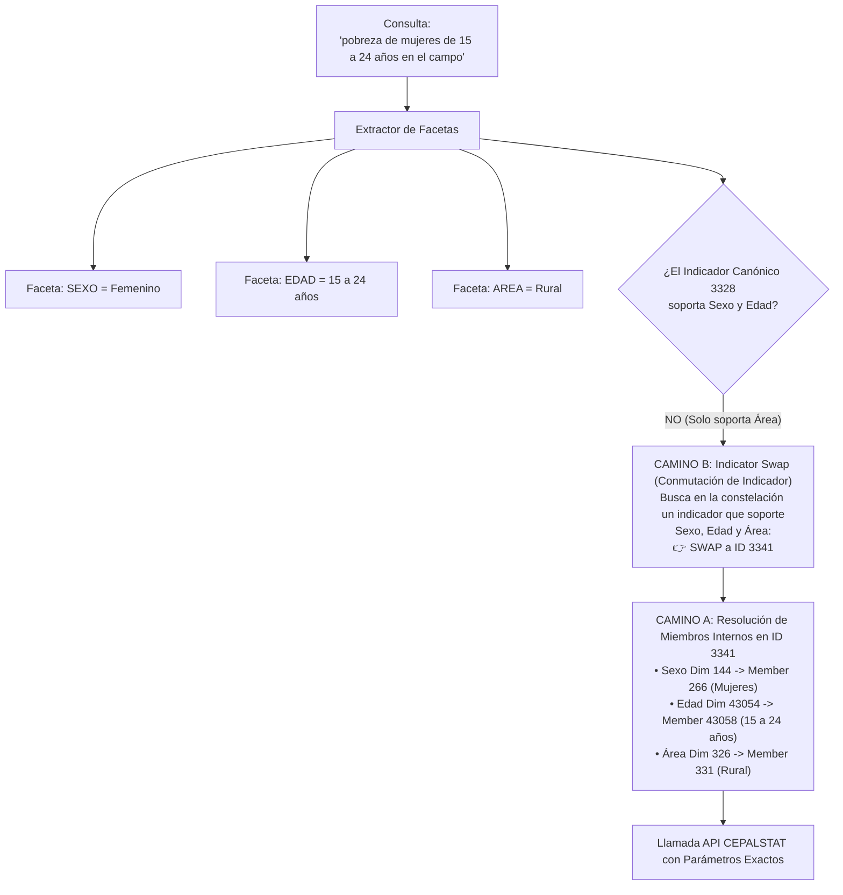

# Sesión 2: Diccionario Universal de Facetas y Modificadores Semánticos

> **Módulo:** Motor Semántico de Desambiguación para el MCP no oficial de CEPALSTAT  
> **Documento:** Especificación Arquitectónica y Ontológica — Pilar 2 de 4  
> **Fecha:** Octubre 2026  
> **Ámbito:** Catálogo completo de 2,143+ indicadores de la Comisión Económica para América Latina y el Caribe (CEPAL / ECLAC)  
> **Autores / Panel BMAD:** Raúl Prebisch (Econometrista Macro-estructuralista), Winston (Arquitecto de Sistemas), Amelia (Senior Dev), Sally (UX/AI Interaction), Mary (Analista de Datos y Negocio), John (Product Manager).

---

## 1. El Problema de las Facetas en Lenguaje Natural

En la **Sesión 1** resolvimos la identificación unívoca del **Fenómeno Raíz** (por ejemplo, `POBREZA_Y_VULNERABILIDAD`). Sin embargo, una consulta real nunca viene aislada:

> *"¿Cuál es la pobreza de mujeres jóvenes en el campo en Brasil?"*  
> *"Mostrame el desempleo juvenil de los pibes en Argentina"*  
> *"Déficit habitacional en el quintil más pobre y en zonas rurales"*  
> *"Brecha salarial formal vs en negro en Colombia"*

El lenguaje natural latinoamericano está plagado de regionalismos (*pibas, chavos, en negro, chamba informal, el campo, la ciudad, tercera edad*). Si un MCP solo busca palabras literales de la API (*"Total del área rural"*, *"Mujeres"*, *"15 a 24 años"*), ignorará más del 80% de las consultas reales.

Más aún: **en CEPALSTAT las facetas no operan de forma homogénea**. Existen dos arquitecturas de indicadores radicalmente diferentes:



---

## 2. La Mecánica Dual de Resolución de Facetas

El motor semántico implementa una regla formal de dos caminos (*Dual-Path Resolution*):

### Camino A: Filtrado de Miembros Internos (*Member In-Indicator Filtering*)
Ocurre cuando el indicador objetivo ya posee dimensiones parametrizables en el endpoint `/dimensions`.  
*Ejemplo:* El indicador `3328` posee la dimensión nativa `1364` (*Área geográfica*). Si el usuario pide *"zona rural"*, el motor no cambia de indicador; inyecta el `member_id=1367` (*Total del área rural*) en el payload.

### Camino B: Conmutación de Indicador Canónico (*Indicator Swap*)
Ocurre cuando el indicador canónico por omisión **carece estructuralmente** de una dimensión requerida.  
*Ejemplo empírico comprobado:* El indicador `3328` **NO tiene dimensión de Sexo ni de Grupo de Edad**. Si el usuario pide *"pobreza de mujeres"*, intentar filtrar miembros en el `3328` resulta en error o datos ciegos al género. El motor detecta la faceta `SEXO=FEMENINO`, consulta la constelación del fenómeno `POBREZA_Y_VULNERABILIDAD`, y **conmuta el indicador al ID `3341`** (*Tasa de incidencia de la pobreza según sexo y edad*), donde sí existen las dimensiones `144` (*Sexo*) y `43054` (*Grupo de edad*).

---

## 3. Diccionario Universal de Facetas

Definimos **9 Facetas Universales Canónicas**, sus valores estandarizados, su mapeo léxico exhaustivo (incluyendo regionalismos latinoamericanos) y los miembros típicos de CEPALSTAT.

---

### Faceta 1: `AREA` (Área Geográfica / Dominio Territorial)

| Valor Canónico | Miembro Estándar CEPAL | Expresiones y Regionalismos en Lenguaje Natural |
|---|---|---|
| `TOTAL_NACIONAL` | `Nacional` / `Total país` | `nacional`, `todo el pais`, `pais completo`, `total nacional`, `a nivel pais`, `consolidado`, `national` |
| `RURAL` | `Total del área rural` / `Rural` | `rural`, `el campo`, `campo`, `zona rural`, `campesino`, `interior rural`, `agro`, `agrario`, `pueblos chicos` |
| `URBANO` | `Total del área urbana` / `Urbana` | `urbano`, `zona urbana`, `ciudades`, `ciudad`, `casco urbano`, `aglomerados urbanos`, `urban` |
| `METROPOLITANO` | `Área metropolitana` / `Capital` | `area metropolitana`, `metropolitano`, `capital`, `gran buenos aires`, `region metropolitana`, `cdmx`, `amva`, `conurbano` |

---

### Faceta 2: `SEXO` (Sexo y Género)

| Valor Canónico | Miembro Estándar CEPAL | Expresiones y Regionalismos en Lenguaje Natural |
|---|---|---|
| `AMBOS` | `Ambos sexos` / `Total` | `ambos sexos`, `total`, `todos`, `toda la poblacion`, `sin distincion de genero`, `general`, `both` |
| `FEMENINO` | `Mujeres` / `Femenino` | `mujeres`, `mujer`, `femenina`, `femenino`, `chicas`, `pibas`, `morras`, `senoras`, `mujeres jefas de hogar`, `female` |
| `MASCULINO` | `Hombres` / `Masculino` | `hombres`, `hombre`, `masculino`, `varones`, `varon`, `chicos`, `pibes`, `caballeros`, `male` |

> **Regla Especial de Desambiguación (Raúl & Sally):**  
> Si el usuario dice *"pobreza femenina"*, además de mapear a `SEXO=FEMENINO`, el motor semántico genera un enlace cruzado de evaluación con el fenómeno `AUTONOMIA_ECONOMICA_Y_CUIDADOS` para verificar si el usuario busca el **Índice de Feminidad de la Pobreza** (`ID 3330`: número de mujeres en hogares pobres por cada 100 hombres).

---

### Faceta 3: `EDAD` (Tramo Etario / Ciclo de Vida)

| Valor Canónico | Rango de Años Oficial | Expresiones y Regionalismos en Lenguaje Natural |
|---|---|---|
| `PRIMERA_INFANCIA` | 0 a 5 años | `primera infancia`, `bebes`, `ninos pequenos`, `lactantes`, `0 a 5 anos` |
| `INFANCIA` | 0 a 14 años | `ninos`, `ninas`, `chicos`, `infancia`, `menores de edad`, `infantil`, `pibitos`, `0 a 14 anos`, `children` |
| `JUVENTUD` | 15 a 24 años | `jovenes`, `juventud`, `adolescentes`, `chavos`, `pibes`, `chicos jovenes`, `primer empleo`, `15 a 24 anos`, `youth` |
| `ADULTOS_JOVENES` | 25 a 34 años | `adultos jovenes`, `profesionales jovenes`, `25 a 34 anos` |
| `ADULTOS` | 35 a 64 años | `adultos`, `edad madura`, `poblacion en edad activa`, `35 a 64 anos` |
| `ADULTOS_MAYORES` | 65 años y más | `tercera edad`, `adultos mayores`, `abuelos`, `ancianos`, `viejos`, `jubilados`, `pensionados`, `65 y mas`, `elderly` |

---

### Faceta 4: `SEVERIDAD_POBREZA` (Umbral y Profundidad de Pobreza)

| Valor Canónico | Métrica Canónica CEPAL | Expresiones en Lenguaje Natural |
|---|---|---|
| `POBREZA_TOTAL` | Pobreza (Canasta básica total) | `pobreza`, `pobreza total`, `bajo la linea de pobreza`, `pobres`, `pobreza moderada` |
| `POBREZA_EXTREMA` | Pobreza extrema (Canasta básica alimentaria) | `pobreza extrema`, `indigencia`, `extrema pobreza`, `miseria`, `indigentes`, `hambre`, `linea de indigencia` |
| `LINEA_INTERNACIONAL`| ODS 1.1.1 (Línea USD 2.15 / día PPA) | `linea internacional`, `pobreza internacional`, `banco mundial`, `extrema pobreza ods`, `2 dolares diarios` |

---

### Faceta 5: `ESTRATO_INGRESO` (Estratificación Socioeconómica y Deciles)

| Valor Canónico | Segmento Oficial | Expresiones y Regionalismos en Lenguaje Natural |
|---|---|---|
| `QUINTIL_1` | Quintil I (20% más vulnerable) | `quintil 1`, `primer quintil`, `los mas pobres`, `20% mas pobre`, `estrato bajo`, `quintil inferior` |
| `QUINTIL_2` | Quintil II | `quintil 2`, `segundo quintil` |
| `QUINTIL_3` | Quintil III (Estrato medio) | `quintil 3`, `tercer quintil`, `clase media`, `estrato medio` |
| `QUINTIL_4` | Quintil IV | `quintil 4`, `cuarto quintil` |
| `QUINTIL_5` | Quintil V (20% más rico) | `quintil 5`, `quinto quintil`, `los mas ricos`, `20% mas rico`, `estrato alto`, `quintil superior` |
| `DECIL_1` | Decil 1 (10% más pobre) | `decil 1`, `primer decil`, `10% mas vulnerable` |
| `DECIL_10` | Decil 10 (10% más rico) | `decil 10`, `decimo decil`, `el 10% mas rico`, `los ultraricos`, `la cima de la distribucion` |
| `RATIO_PALMA` | Decil 10 / Deciles 1 a 4 | `ratio palma`, `indice palma`, `relacion palma` |

---

### Faceta 6: `FORMALIDAD_LABORAL` (Condición de Inserción Laboral)

| Valor Canónico | Categoría Estadística | Expresiones y Regionalismos en Lenguaje Natural |
|---|---|---|
| `INFORMAL` | Empleo informal / Sector informal | `informal`, `informalidad`, `en negro`, `chamba informal`, `sin contrato`, `sin aportes`, `precario`, `ambulante` |
| `FORMAL` | Empleo formal / Asalariado con seguridad social | `formal`, `formalidad`, `en blanco`, `con contrato`, `con aportes`, `registrado`, `con seguridad social` |
| `CUENTA_PROPIA` | Trabajadores por cuenta propia | `cuenta propia`, `cuentapropista`, `independiente`, `autonomo`, `freelance`, `emprendedor` |
| `ASALARIADO` | Empleados y obreros dependientes | `asalariado`, `empleado dependiente`, `en relacion de dependencia`, `obrero`, `trabajador a sueldo` |
| `TRABAJO_DOMESTICO`| Trabajadoras/es del hogar remunerados | `trabajo domestico`, `empleadas domesticas`, `trabajadoras del hogar`, `servicio domestico` |

---

### Faceta 7: `NIVEL_EDUCATIVO` (Escolaridad Alcanzada)

| Valor Canónico | Tramo Estadístico | Expresiones en Lenguaje Natural |
|---|---|---|
| `SIN_INSTRUCCION` | Sin instrucción / Analfabeto | `sin educacion`, `sin estudios`, `analfabetos`, `sin instruccion`, `0 anos de estudio` |
| `PRIMARIA` | Primaria incompleta o completa | `primaria`, `educacion basica`, `primaria completa`, `hasta 6 anos de estudio` |
| `SECUNDARIA` | Secundaria incompleta o completa | `secundaria`, `bachillerato`, `educacion media`, `liceo`, `secundaria completa`, `colegio` |
| `SUPERIOR` | Terciaria o Universitaria | `universitarios`, `universidad`, `superior`, `terciario`, `tecnicos`, `graduados`, `profesionales` |

---

### Faceta 8: `ETNICIDAD` (Pertenencia Étnico-Racial)

| Valor Canónico | Grupo Oficial CEPAL | Expresiones en Lenguaje Natural |
|---|---|---|
| `INDIGENA` | Población indígena | `indigena`, `indigenas`, `pueblos originarios`, `nativos`, `etnias autoctonas`, `comunidades originarias` |
| `AFRODESCENDIENTE`| Población afrodescendiente | `afrodescendientes`, `afro`, `comunidades negras`, `poblacion negra`, `afrolatinos` |
| `NO_INDIGENA` | No indígena ni afrodescendiente | `no indigena`, `resto de la poblacion`, `no afro` |

---

### Faceta 9: `SECTOR_ECONOMICO` (Rama de Actividad Económica)

| Valor Canónico | Rama CIIU / División | Expresiones en Lenguaje Natural |
|---|---|---|
| `AGROPECUARIO` | Agricultura, ganadería, silvicultura y pesca | `agro`, `agricultura`, `campo`, `sector agropecuario`, `ganaderia`, `pesca` |
| `MANUFACTURA` | Industrias manufactureras | `industria`, `manufactura`, `fabricas`, `sector manufacturero`, `produccion fabril` |
| `CONSTRUCCION` | Construcción de obras y viviendas | `construccion`, `obras`, `albanileria`, `sector de la construccion` |
| `COMERCIO` | Comercio mayorista y minorista | `comercio`, `tiendas`, `retail`, `ventas comerciales` |
| `SERVICIOS` | Servicios financieros, empresariales y personales | `servicios`, `sector terciario`, `hoteleria`, `turismo`, `finanzas` |
| `MINERIA` | Explotación de minas y canteras, hidrocarburos | `mineria`, `petroleo`, `hidrocarburos`, `gas`, `extraccion minera` |

---

## 4. Algoritmo de Extracción y Enrutamiento de Facetas

El algoritmo opera en tres pasos deterministas:

```python
class FacetExtractionEngine:
    """Extrae facetas normalizadas a partir de la consulta del usuario."""

    def extract_facets(self, query: str) -> dict[str, str]:
        normalized_q = strip_accents_and_punctuation(query.lower())
        detected_facets: dict[str, str] = {}

        # 1. Escaneo de diccionarios de facetas
        for facet_name, dictionary in UNIVERSAL_FACET_REGISTRY.items():
            for canonical_val, token_list in dictionary.items():
                if any(token in normalized_q for token in token_list):
                    detected_facets[facet_name] = canonical_val
                    break

        return detected_facets

    def resolve_target_indicator(
        self,
        root_slug: str,
        detected_facets: dict[str, str],
        catalog_store: CatalogStore,
    ) -> ResolvedIndicatorPayload:
        root_meta = ROOT_PHENOMENA_REGISTRY[root_slug]
        canonical_id = root_meta.canonical_id
        constellation = root_meta.constellation_ids

        # ¿El indicador canónico soporta todas las facetas requeridas?
        supported = check_dimensions_support(canonical_id, detected_facets)
        if supported:
            # Camino A: Usamos el canónico y resolvemos miembros internos
            member_ids = map_facets_to_members(canonical_id, detected_facets)
            return ResolvedIndicatorPayload(
                indicator_id=canonical_id,
                swap_occurred=False,
                applied_members=member_ids,
            )

        # Camino B: Indicator Swap
        for candidate_id in constellation:
            if check_dimensions_support(candidate_id, detected_facets):
                member_ids = map_facets_to_members(candidate_id, detected_facets)
                return ResolvedIndicatorPayload(
                    indicator_id=candidate_id,
                    swap_occurred=True,
                    swapped_from=canonical_id,
                    applied_members=member_ids,
                )

        # Fallback graceful: retorna el canónico con advertencia de cobertura parcial
        return ResolvedIndicatorPayload(
            indicator_id=canonical_id,
            swap_occurred=False,
            unsupported_facets=get_unsupported_facets(canonical_id, detected_facets),
        )
```

---

## 5. Integración con el Servidor MCP

En el servidor MCP no oficial de CEPALSTAT, este motor se materializa en la herramienta de parsing y en el enriquecimiento de metadatos:

### 5.1 Herramienta de Desambiguación de Facetas
- **Tool:** `cepalstat_parse_facets`
- **Entrada:** `{"query": "pobreza de mujeres de 15 a 24 años en zona rural de Brasil 2021"}`
- **Salida:**
  ```json
  {
    "root_phenomenon": "POBREZA_Y_VULNERABILIDAD",
    "detected_facets": {
      "SEXO": "FEMENINO",
      "EDAD": "JUVENTUD",
      "AREA": "RURAL",
      "PAIS": "BRA",
      "ANIO": "2021"
    },
    "canonical_default_id": 3328,
    "resolved_indicator_id": 3341,
    "resolution_strategy": "INDICATOR_SWAP",
    "swap_reason": "Indicator 3328 lacks Sexo and Grupo de edad dimensions. Indicator 3341 satisfies both.",
    "resolved_members": {
      "144": {"name": "Sexo__ESTANDAR", "member_id": 266, "member_name": "Mujeres"},
      "43054": {"name": "Grupo de edad", "member_id": 43058, "member_name": "15 a 24 años"},
      "326": {"name": "Área geográfica", "member_id": 331, "member_name": "Rural"}
    }
  }
  ```

---

## 6. Próximo Paso: Hacia la Sesión 3

Con el Diccionario Universal de Facetas y Modificadores y el algoritmo de conmutación formalizados en esta **Sesión 2**, el siguiente paso crítico es:

👉 **Sesión 3:** [`03-mecanismo-prominencia-enrutamiento.md`](./03-mecanismo-prominencia-enrutamiento.md)  
*Mecanismo de Prominencia y Grafo de Enrutamiento Canónico: Definición matemática de la función de scoring $P(I \mid \mathcal{Q})$, ponderación de cobertura temporal y geográfica, backbone de indicadores canónicos por omisión y resolución de empates.*
