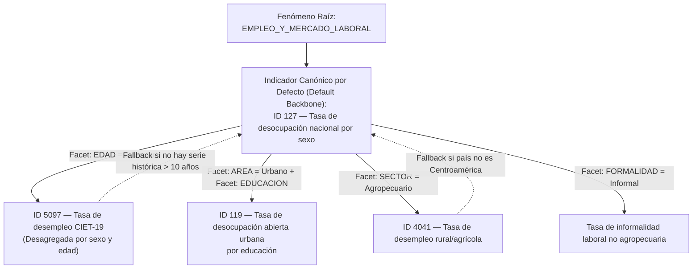

# Sesión 3: Mecanismo de Prominencia y Grafo de Enrutamiento Canónico

> **Módulo:** Motor Semántico de Desambiguación para el MCP no oficial de CEPALSTAT  
> **Documento:** Especificación Arquitectónica y Ontológica — Pilar 3 de 4  
> **Fecha:** Octubre 2026  
> **Ámbito:** Catálogo completo de 2,143+ indicadores de la Comisión Económica para América Latina y el Caribe (CEPAL / ECLAC)  
> **Autores / Panel BMAD:** Raúl Prebisch (Econometrista Macro-estructuralista), Winston (Arquitecto de Sistemas), Amelia (Senior Dev), Sally (UX/AI Interaction), Mary (Analista de Datos y Negocio), John (Product Manager).

---

## 1. El Problema de la Prominencia y la Ambigüedad Competitiva

En las sesiones previas establecimos:
1. **Sesión 1:** El reconocimiento del **Fenómeno Raíz** ($\mathcal{P}_{\text{root}} \in \mathbf{Roots}$, ej. `CRECIMIENTO_Y_PIB`).
2. **Sesión 2:** La extracción de **Facetas y Modificadores** ($\mathcal{F} \subset \mathbf{Facets}$, ej. `PAIS=ARG`, `ANIO=2022`).

Sin embargo, incluso tras identificar el fenómeno raíz y las facetas, el motor se enfrenta frecuentemente a **Múltiples Indicadores Rivales Competitivos**:

- Si el usuario pide *"PIB de Colombia"*, en el catálogo coexisten:
  - `2203`: PIB anual a precios constantes en dólares (serie armonizada estándar para comparabilidad internacional).
  - `2204`: PIB anual a precios corrientes en moneda nacional (afectado por inflación local).
  - `2206`: PIB per cápita a precios constantes en dólares.
  - `2447`: PIB trimestral desestacionalizado.
  - `4548`: Crecimiento de exportaciones en tablero macroeconómico ODS.

- Si el usuario pide *"Desempleo en Uruguay"*, coexisten:
  - `127`: Tasa de desocupación nacional armonizada por CEPAL (cobertura total país).
  - `119`: Tasa de desocupación abierta urbana por años de educación (solo centros urbanos).
  - `5097`: Tasa de desempleo CIET-19 (ODS 8.5.2, con metodología estricta OIT pero menor cobertura histórica).
  - `4041`: Tasa de desempleo agrícola (solo proyectos subregionales de Centroamérica y México).

Si el MCP devuelve el primer resultado aleatorio de una búsqueda textual, el usuario puede recibir una serie urbana cuando buscaba la nacional, o una serie en moneda corriente cuando esperaba volumen real constante.

Para resolver esto de forma determinista y científicamente rigurosa, definimos la **Función de Prominencia Multicriterio** y el **Grafo de Enrutamiento Canónico**.

---

## 2. Formulación Matemática del Score de Prominencia $P(I \mid \mathcal{Q})$

Dado un indicador candidato $I$ perteneciente a la constelación del fenómeno raíz $\mathcal{P}_{\text{root}}$ disparado por la consulta $\mathcal{Q}$, su **Puntuación de Prominencia** $P(I \mid \mathcal{Q}) \in [0, 1]$ se calcula mediante la función ponderada:

$$P(I \mid \mathcal{Q}) = w_{\text{root}} \cdot S_{\text{root}}(I) + w_{\text{facet}} \cdot S_{\text{facet}}(I, \mathcal{F}) + w_{\text{cov}} \cdot S_{\text{cov}}(I, \mathcal{G}, \mathcal{T}) + w_{\text{auth}} \cdot A(I) - \Omega(I)$$

Con la restricción de normalización de pesos:
$$\sum w = w_{\text{root}} + w_{\text{facet}} + w_{\text{cov}} + w_{\text{auth}} = 1.0$$
Pesos calibrados por defecto en el sistema:
- $w_{\text{root}} = 0.35$ (Relevancia y canonicalidad del fenómeno raíz)
- $w_{\text{facet}} = 0.30$ (Ajuste dimensional a las facetas solicitadas)
- $w_{\text{cov}} = 0.20$ (Densidad y cobertura empírica espacio-temporal)
- $w_{\text{auth}} = 0.15$ (Nivel de armonización y autoridad estadística CEPAL)

---

### 2.1 Definición de las Componentes del Score

#### A. Similitud y Canonicalidad Raíz: $S_{\text{root}}(I) \in [0, 1]$
Evalúa si el indicador $I$ es el representante canónico oficial por defecto del fenómeno raíz.
- $S_{\text{root}}(I) = 1.0$ si $I$ es el indicador canónico por defecto designado en la **Sesión 1** (ej. `2203` para PIB, `3328` para Pobreza, `127` para Desocupación).
- $S_{\text{root}}(I) = 0.70$ si $I$ es un miembro primario de la constelación temática.
- $S_{\text{root}}(I) = 0.40$ si $I$ es un indicador transversal u ODS secundario.

#### B. Coincidencia Dimensional de Facetas: $S_{\text{facet}}(I, \mathcal{F}) \in [0, 1]$
Mide la proporción de facetas requeridas por la consulta $\mathcal{F}$ que son efectivamente soportadas por las dimensiones nativas de $I$:

$$S_{\text{facet}}(I, \mathcal{F}) = \frac{|\mathcal{F}_{\text{requeridas}} \cap \mathcal{D}(I)|}{|\mathcal{F}_{\text{requeridas}}|}$$

Donde $\mathcal{D}(I)$ es el conjunto de dimensiones que posee el indicador $I$.
- Si el usuario no especificó ninguna faceta (ej. *"pobreza de Brasil"*), $S_{\text{facet}} = 1.0$ para indicadores agregados nacionales, pero se penaliza a indicadores hiperespecíficos.
- Si el usuario pidió *"mujeres jóvenes rurales"*, un indicador que posea dimensiones de Sexo, Edad y Área obtiene $S_{\text{facet}} = 1.0$, mientras que uno que solo posea Área obtiene $S_{\text{facet}} = 0.33$.

#### C. Cobertura Empírica Espacio-Temporal: $S_{\text{cov}}(I, \mathcal{G}, \mathcal{T}) \in [0, 1]$
Evita recomendar indicadores que teóricamente son atractivos pero que en la práctica tienen series vacías o discontinuadas para el país $\mathcal{G}$ o período $\mathcal{T}$ solicitados:

$$S_{\text{cov}}(I, \mathcal{G}, \mathcal{T}) = 0.5 \cdot \left(\frac{N_{\text{paises con datos}}}{33}\right) + 0.5 \cdot \mathbb{I}(\text{dato disponible para } \mathcal{G} \text{ en } \mathcal{T})$$

Donde $\mathbb{I}(\cdot)$ es la función indicatriz de disponibilidad local comprobada en el catálogo.

#### D. Nivel de Autoridad y Armonización CEPAL: $A(I) \in [0, 1]$
Jerarquía metodológica de las series en CEPALSTAT:
- **Tier 1 ($A = 1.0$):** *Series Armonizadas CEPAL*. Procesadas por las divisiones sustantivas (Desarrollo Social, Desarrollo Económico) con homogeneización metodológica entre países (ej. Pobreza por línea canasta básica CEPAL, PIB constante).
- **Tier 2 ($A = 0.8$):** *Indicadores Oficiales ODS de Naciones Unidas*. Series provistas por agencias custodias globales (UNESCO, OIT, OMS, Banco Mundial).
- **Tier 3 ($A = 0.5$):** *Series Nacionales No Armonizadas*. Datos directos de institutos de estadística nacionales (INDEC, IBGE, INEGI) sin ajuste metodológico regional.
- **Tier 4 ($A = 0.3$):** *Proyectos Subregionales o Módulos Especiales* (ej. tabulados que solo abarcan Centroamérica y el Caribe).

#### E. Penalización por Hiperespecificidad Huérfana: $\Omega(I) \ge 0$
Si un indicador contiene restricciones dimensionales que el usuario **no solicitó**, se aplica una penalización para proteger la respuesta general:
- Ejemplo: Si el usuario pidió *"desempleo"*, el indicador `4041` (*Tasa de desempleo agrícola*) recibe una penalización $\Omega = 0.35$ porque introduce la restricción 'agrícola' que nadie pidió.

---

## 3. El Grafo de Enrutamiento Canónico (DAG)

Para materializar este cálculo de forma eficiente sin reevaluar todo el catálogo en cada petición, la ontología se estructura como un **Grafo Dirigido Acíclico de Enrutamiento**:



### 3.1 Propiedades del Grafo de Enrutamiento:
1. **Backbone Canónico Indestructible:** Toda consulta siempre tiene garantizado un nodo de entrada canónico con cobertura universal regional (Tier 1).
2. **Conmutación Determinista de Nodos:** Las aristas representan condiciones booleanas sobre las facetas ($\mathcal{F}$). Si las condiciones se cumplen y el score de cobertura es positivo, el enrutador conmuta hacia el nodo hijo especializado.
3. **Aristas de Retorno / Fallback Heurístico:** Si el nodo especializado carece de datos para el país específico (por ejemplo, encuestas agrícolas de Centroamérica consultadas para Chile), la arista de fallback devuelve la consulta al nodo padre canónico con una advertencia explicativa.

---

## 4. Matriz de Prominencia para Casos Paradigmáticos de CEPALSTAT

A continuación se detalla cómo el mecanismo de prominencia resuelve los dilemas semánticos más frecuentes del catálogo:

| Consulta del Usuario | Candidato A | Candidato B | Indicador Ganador | Razón de la Decisión Algorítmica |
|---|---|---|:---:|---|
| *"PIB de Brasil"* | `2203` (PIB a precios constantes en USD) | `2204` (PIB a precios corrientes en moneda nacional) | **2203** | `2203` tiene $S_{\text{root}}=1.0$ (Canónico) y $A(I)=1.0$ (Serie constante internacional para comparabilidad). |
| *"Inflación en Argentina"* | `365` (IPC General) | `2929` (Variación 12 meses alimentos) | **365** | La consulta carece de faceta 'alimentos'; `2929` sufre penalización por especificidad huérfana $\Omega$. Gana el IPC general. |
| *"Inflación de alimentos en Colombia"* | `365` (IPC General) | `2929` (Variación 12 meses alimentos) | **2929** | Se activa la faceta `CANASTA=ALIMENTOS`. `2929` alcanza $S_{\text{facet}}=1.0$ mientras que `365` solo $0.30$. Swap exitoso. |
| *"Pobreza de mujeres en Chile"* | `3328` (Pobreza por área) | `3341` (Pobreza por sexo y edad) | **3341** | `3328` carece de dimensión Sexo ($S_{\text{facet}}=0$). Conmuta a `3341` donde $S_{\text{facet}}=1.0$ (Camino B). |
| *"Desempleo de jóvenes en México"* | `127` (Desocupación nacional por sexo) | `5097` (Desempleo por sexo y edad ODS) | **5097** | La faceta `EDAD=JUVENTUD` activa la arista hacia `5097` que soporta el tramo etario 15-24 años nativamente. |

---

## 5. Resolución de Empates y Proactividad Conversacional

Cuando dos indicadores obtienen puntuaciones muy cercanas ($|P(I_1) - P(I_2)| \le 0.05$), el motor semántico aplica dos protocolos:

### Protocolo A: Desempate Estructural
1. Prevalece el indicador con **mayor cobertura temporal histórica** (más años continuos en CEPALSTAT).
2. Si persiste el empate, prevalece el indicador de **cobertura geográfica nacional** sobre la urbana o subnacional.

### Protocolo B: Proactividad Conversacional (Diseño UX de Sally)
El servidor MCP no toma la decisión en silencio. El payload de respuesta incluye un campo de metadatos `proactive_suggestion` diseñado para que el cliente LLM enriquezca su diálogo con el usuario:

```json
{
  "winner": {
    "indicator_id": 3341,
    "name": "Tasa de incidencia de la pobreza según sexo y edad",
    "score": 0.94,
    "applied_facets": {"sexo": "Mujeres", "area": "Nacional"}
  },
  "runner_up": {
    "indicator_id": 3330,
    "name": "Índice de feminidad de la pobreza",
    "score": 0.89,
    "difference_reason": "Mide la relación de mujeres pobres por cada 100 hombres pobres en lugar del porcentaje absoluto."
  },
  "conversational_hint": "He obtenido la tasa de pobreza de mujeres (3341: 28.4%). ¿Deseas además conocer el Índice de Feminidad de la Pobreza (3330), que mide cuántas mujeres pobres hay por cada 100 hombres?"
}
```

---

## 6. Especificación de la Herramienta MCP

### Herramienta: `cepalstat_score_indicators`
- **Propósito:** Evaluar y rankear una lista de indicadores candidatos para una consulta dada, retornando el indicador óptimo y el desglose de puntajes.
- **Entrada:**
  ```json
  {
    "query": "pobreza femenina en Brasil",
    "root_slug": "POBREZA_Y_VULNERABILIDAD",
    "detected_facets": {"sexo": "FEMENINO", "pais": "BRA"},
    "candidate_ids": [3328, 3341, 3330, 3337]
  }
  ```
- **Salida:**
  ```json
  {
    "selected_indicator": {
      "indicator_id": 3341,
      "name": "Tasa de incidencia de la pobreza según sexo y edad",
      "final_score": 0.935,
      "breakdown": {
        "root_score": 0.70,
        "facet_match": 1.00,
        "coverage_score": 0.95,
        "authority_tier": 1.00,
        "penalty": 0.00
      }
    },
    "alternatives": [
      {
        "indicator_id": 3330,
        "name": "Índice de feminidad de la pobreza",
        "final_score": 0.880,
        "role": "Métrica de brecha relativa hombre/mujer"
      },
      {
        "indicator_id": 3328,
        "name": "Población en situación de pobreza extrema y pobreza, por área",
        "final_score": 0.650,
        "role": "Canónico nacional (descartado por carecer de dimensión de sexo)"
      }
    ],
    "explanation": "El indicador canónico 3328 fue descartado debido a que no soporta desagregación por sexo. El indicador 3341 es seleccionado con el score más alto por compatibilidad total con la faceta 'FEMENINO' y máxima autoridad estadística armonizada."
  }
  ```

---

## 7. Próximo Paso: Hacia la Sesión 4

Con el mecanismo de prominencia, la función de scoring y el grafo de enrutamiento formalizados en esta **Sesión 3**, completamos la trilogía semántica fundamental. La última sesión abordará el desafío de las series temporales:

👉 **Sesión 4:** [`04-frecuencia-disponibilidad-temporal.md`](./04-frecuencia-disponibilidad-temporal.md)  
*Frecuencia, Periodicidad y Brechas de Disponibilidad Temporal: Manejo de encuestas de hogares bienales vs. anuales vs. trimestrales, desfase temporal de publicación oficial (*timeliness lag*) y heurísticas de interpolación o fallback temporal.*
