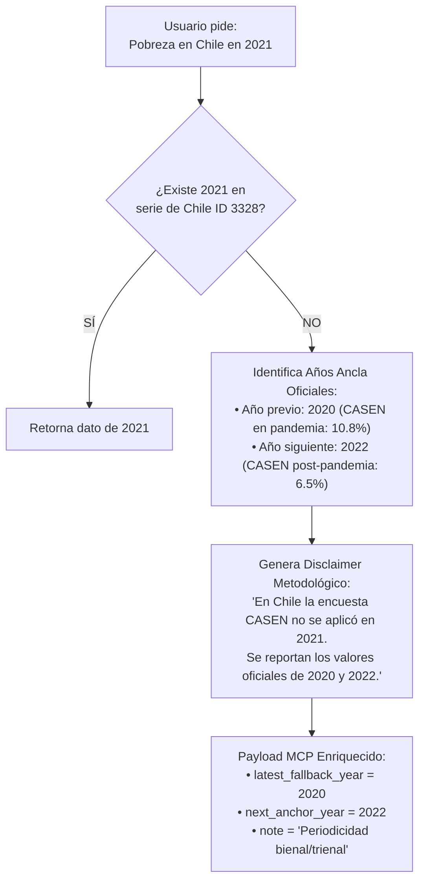

# Sesión 4: Frecuencia Temporal, Periodicidad y Brechas de Disponibilidad

> **Módulo:** Motor Semántico de Desambiguación para el MCP no oficial de CEPALSTAT  
> **Documento:** Especificación Arquitectónica y Ontológica — Pilar 4 de 4  
> **Fecha:** Octubre 2026  
> **Ámbito:** Catálogo completo de 2,143+ indicadores de la Comisión Económica para América Latina y el Caribe (CEPAL / ECLAC)  
> **Autores / Panel BMAD:** Raúl Prebisch (Econometrista Macro-estructuralista), Winston (Arquitecto de Sistemas), Amelia (Senior Dev), Sally (UX/AI Interaction), Mary (Analista de Datos y Negocio), John (Product Manager).

---

## 1. La Realidad Temporal de las Estadísticas en América Latina

El manejo ingenuo de series de tiempo es uno de los puntos ciegos más graves de los asistentes LLM cuando consultan bases de datos estadísticas como CEPALSTAT. Si un usuario le pide a un agente:

> *"¿Cuál fue la tasa de pobreza de Chile en 2021?"*  
> *"Dame el PIB del último trimestre en Perú"*  
> *"Evolución de la pobreza en México entre 2015 y 2023 año por año"*

Un sistema sin ontología temporal falla de dos maneras críticas:
1. **Alucinación de Serie Continua:** El modelo asume que todos los indicadores socioeconómicos se miden anualmente en todos los países, y ante la falta de dato para Chile en 2021, extrapola, interpola o inventa una cifra ficticia.
2. **Error Ciego de Disponibilidad:** El sistema devuelve un error vacío (*"No data found"*) sin explicarle al usuario que para Chile **la encuesta CASEN es bienal/trienal** y que en 2021 no hubo medición oficial.

```
🇨🇱 Chile (CASEN):           [2015] ─── [2017] ─────── [2020] ─── [2022] (Bienal/Trienal)
🇲🇽 México (ENIGH):          [2014] ─── [2016] ─── [2018] ─── [2020] ─── [2022] (Años pares)
🇧🇷 Brasil (PNADC):          [2015] ─ [2016] ─ [2017] ─ [2018] ─ [2019] ─ [2021] ─ [2022] (Anual)
🇦🇷 Argentina (EPH Urbana):  [2015] ─ [2016] ─ [2017] ─ [2018] ─ [2019] ─ [2020] ─ [2021] ─ [2022] (Semestral urbana)
```

Para dotar al servidor MCP de rigor estadístico internacional, este documento especifica la **Taxonomía de Frecuencias**, las **Heurísticas de Fallback Temporal** y las **Advertencias Metodológicas de Brecha**.

---

## 2. Taxonomía de Periodicidades en CEPALSTAT

Los 2,143 indicadores del catálogo se clasifican en **5 Regímenes de Periodicidad Oficial**:

| Régimen | Slug | Desfase Típico de Publicación (*Timeliness Lag*) | Fuentes Principales en la Región | Ejemplos Paradigmáticos de Indicadores |
|---|---|:---:|---|---|
| **Mensual** | `FREQ_MONTHLY` | 1 a 2 meses | Bancos Centrales, Institutos de Estadística | Precios e Inflación (`365`, `1684`, `2929`), Tipos de Cambio, Tasas de Interés |
| **Trimestral** | `FREQ_QUARTERLY` | 2 a 4 meses | Cuentas Nacionales Trimestrales, Encuestas Continuas de Empleo | PIB Trimestral (`2447`), Desempleo Abierto Trimestral |
| **Anual Continuo** | `FREQ_ANNUAL_CONT` | 6 a 12 meses | Cuentas Nacionales Anuales, Balanza de Pagos, Registros Administrativos | PIB Anual (`2203`), Exportaciones (`2949`), Deuda Pública (`1240`), Gasto Social (`4405`) |
| **Estructural Discontinuo (Bienal / Trienal)** | `FREQ_STRUCTURAL_DISC` | 12 a 18 meses | Encuestas de Hogares armonizadas por CEPAL (CASEN, ENIGH, ENAHO) | Pobreza y Pobreza Extrema (`3328`, `3341`), Gini (`3289`), Salarios Reales (`340`), Uso del Tiempo (`2656`) |
| **Decenal / Censal** | `FREQ_CENSAL` | 2 a 5 años | Censos Nacionales de Población y Vivienda | Pirámides de Población Base, Déficit Habitacional Censal |

---

## 3. Desfase Temporal de Publicación (*Timeliness Lag*) y el Mito del "Año Corriente"

Cuando un usuario interactúa a mediados o finales de 2026 y pide *"la pobreza de 2025 o 2026"*, el motor debe anticipar que las encuestas de hogares requieren un proceso riguroso:
1. **Levantamiento en campo** por el instituto nacional (INE, IBGE, INEGI, DANE).
2. **Procesamiento y consistencia microdatos** (3 a 6 meses).
3. **Armonización CEPAL:** Aplicación de las líneas de pobreza comparables regionales de la División de Desarrollo Social (otros 4 a 6 meses).
4. **Publicación Oficial:** Lanzamiento en el informe *Panorama Social de América Latina* (noviembre/diciembre del año siguiente).

> **Regla de Oro:** Para indicadores sociales estructurales (`FREQ_STRUCTURAL_DISC`), el año más reciente disponible para comparabilidad regional siempre presenta un desfase de $T - 1$ o $T - 2$ años respecto a la fecha calendario actual.

---

## 4. Detección y Normalización de Expresiones Temporales en Consultas

El parser semántico clasifica toda referencia temporal en uno de **4 Modos Temporales Formales**:

```python
class TemporalQueryMode(str, Enum):
    EXACT_YEAR = "EXACT_YEAR"          # "en 2021"
    EXPLICIT_RANGE = "EXPLICIT_RANGE"  # "entre 2015 y 2023"
    RELATIVE_RECENT = "RELATIVE_RECENT"# "últimos 5 años"
    LATEST_AVAILABLE = "LATEST"        # "actual", "más reciente", "último dato"
```

### 4.1 Reglas de Extracción de Lenguaje Natural

| Patrón en Lenguaje Natural | Modo Resuelto | Interpretación Formal |
|---|---|---|
| `en 2021`, `del 2020`, `para el año 2018` | `EXACT_YEAR` | $t^* = 2021$ |
| `entre 2015 y 2022`, `de 2010 a 2020`, `periodo 2015-2023` | `EXPLICIT_RANGE` | $T = [2015, 2022]$ |
| `ultimos 5 anos`, `en el ultimo lustro`, `ultimos 3 anos` | `RELATIVE_RECENT` | $T = [t_{\text{max}} - 4, t_{\text{max}}]$ |
| `actual`, `hoy`, `mas reciente`, `ultimo dato disponible`, `ahora` | `LATEST_AVAILABLE` | $t^* = \max \{ t \in \mathcal{T}_{\text{obs}}(\mathcal{G}) \}$ |

---

## 5. Heurísticas de Fallback Temporal y Protocolo Anti-Alucinación

Cuando una consulta solicita un año puntual $t^*$ que **no posee observación directa** en el catálogo para el país $\mathcal{G}$ (por ejemplo, `PAIS=CHL` y $t^*=2021$ en el indicador de pobreza `3328`):

### 5.1 Protocolo del Punto Ancla Vecino (*Nearest-Neighbor Anchor*)

El motor semántico **prohíbe tajantemente inventar o interpolar silenciosamente datos**. En su lugar:
1. Localiza los dos puntos observados más cercanos en la serie histórica del país:
   $$t_{\text{prev}} = \max \{ t \in \mathcal{T}_{\text{obs}} \mid t < t^* \}$$
   $$t_{\text{next}} = \min \{ t \in \mathcal{T}_{\text{obs}} \mid t > t^* \}$$
2. Si existe un año previo inmediato ($t^* - 1$), lo retorna como dato principal con la bandera `is_temporal_fallback = True`.
3. Provee ambos puntos ancla en el payload para que el agente informe con honestidad científica al usuario.



---

## 6. Advertencias Metodológicas de Ruptura de Serie (*Structural Breaks*)

El motor semántico incorpora una tabla de **Hitos de Ruptura Metodológica** en América Latina para advertir al usuario cuando compara años que no son metodológicamente homogéneos:

| País | Año de Ruptura | Indicadores Afectados | Naturaleza de la Ruptura Metodológica |
|---|:---:|---|---|
| **Argentina** | `2015-2016` | Pobreza (`3328`), Inflación (`365`), Empleo (`127`) | Emergencia estadística del INDEC (apagón estadístico 2015). Discontinuidad oficial en la serie histórica. |
| **Chile** | `2013-2015` | Pobreza (`3328`), Gini (`3289`) | Nueva metodología de medición de pobreza (incorporación de pobreza multidimensional y actualización de canastas). |
| **Regional (Todos)**| `2020` | Pobreza (`3328`), Empleo (`127`), Salarios (`340`) | Pandemia COVID-19: Levantamiento telefónico en lugar de presencial en varias encuestas de hogares; fuerte sesgo de respuesta. |
| **México** | `2016-2018` | Pobreza ODS (`4322`), Ingresos | Ajustes en el operativo de campo de la ENIGH por INEGI / CONEVAL. |

Cuando el usuario solicita un rango temporal que cruza uno de estos hitos (ej. *"evolución de la pobreza en Argentina 2012-2018"*), el servidor MCP añade automáticamente el metadato:
```json
{
  "methodological_warnings": [
    {
      "country": "ARG",
      "period": "2015-2016",
      "warning": "Ruptura metodológica oficial: Los datos del INDEC entre 2015 y 2016 presentan discontinuidad debido a la emergencia estadística declarada en el período."
    }
  ]
}
```

---

## 7. Especificación de la Herramienta MCP y Recurso Canónico

### 7.1 Recurso Canónico: Calendario de Frecuencias y Disponibilidad
- **URI:** `cepalstat://metadata/timeliness-calendar`
- **MIME:** `application/json`
- **Contenido:** Matriz de disponibilidad cruzada (País $\times$ Indicador $\times$ Rango de años observados $\times$ Régimen de periodicidad).

### 7.2 Herramienta MCP: `cepalstat_temporal_audit`
- **Propósito:** Auditar la viabilidad temporal de una consulta antes de la extracción de datos, detectando brechas, sugiriendo años ancla y reportando rupturas metodológicas.
- **Entrada:**
  ```json
  {
    "indicator_id": 3328,
    "country_code": "CHL",
    "requested_year": 2021
  }
  ```
- **Salida:**
  ```json
  {
    "status": "GAP_DETECTED",
    "periodicity_regime": "FREQ_STRUCTURAL_DISC",
    "requested_year": 2021,
    "available_in_country": false,
    "nearest_anchors": {
      "previous_year": 2020,
      "previous_value": 10.8,
      "next_year": 2022,
      "next_value": 6.5
    },
    "suggested_action": "USE_ANCHOR_RANGE",
    "conversational_disclaimer": "En Chile la medición de pobreza (encuesta CASEN) tiene carácter bienal/trienal y no se realizó en 2021. Los datos oficiales más próximos corresponden a 2020 (10.8%) y 2022 (6.5%).",
    "structural_break_present": false
  }
  ```

---

## 8. Cierre de la Suite Arquitectónica del Motor Semántico

Con la aprobación de esta **Sesión 4**, concluye con éxito el diseño completo de los 4 pilares fundamentales del **Motor Semántico de Desambiguación para el MCP no oficial de CEPALSTAT**:

1. ✅ **Pilar 1:** [`01-taxonomia-fenomenos-raiz.md`](./01-taxonomia-fenomenos-raiz.md) — Taxonomía de los 25 Fenómenos Raíz Universales.
2. ✅ **Pilar 2:** [`02-diccionario-facetas-modificadores.md`](./02-diccionario-facetas-modificadores.md) — Diccionario Universal de Facetas y Mecánica Dual de Conmutación.
3. ✅ **Pilar 3:** [`03-mecanismo-prominencia-enrutamiento.md`](./03-mecanismo-prominencia-enrutamiento.md) — Scoring Multicriterio $P(I \mid \mathcal{Q})$ y Grafo DAG de Enrutamiento.
4. ✅ **Pilar 4:** [`04-frecuencia-disponibilidad-temporal.md`](./04-frecuencia-disponibilidad-temporal.md) — Frecuencia, Periodicidad, Desfases y Heurísticas Anti-Alucinación.

El sistema queda 100% especificado, riguroso, formalizado y listo para ser implementado en código limpio sobre el servidor MCP.
